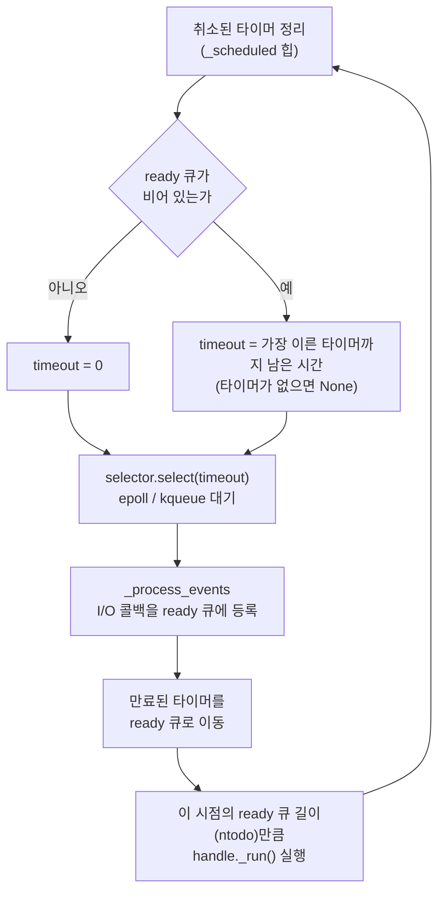
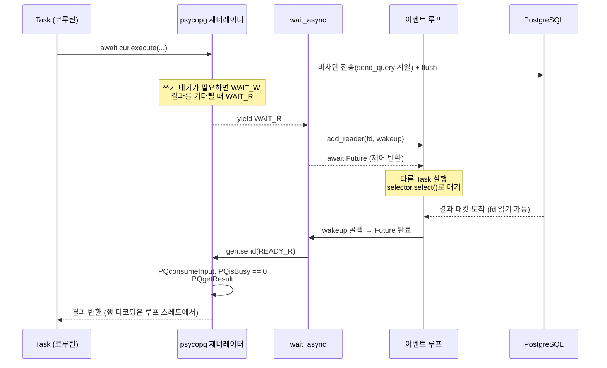
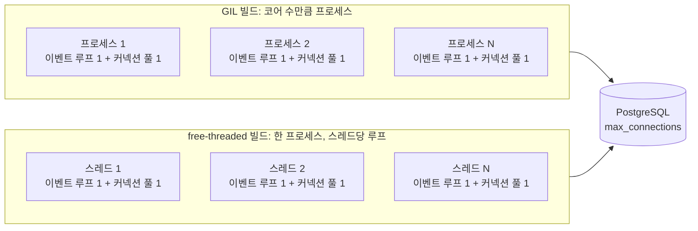
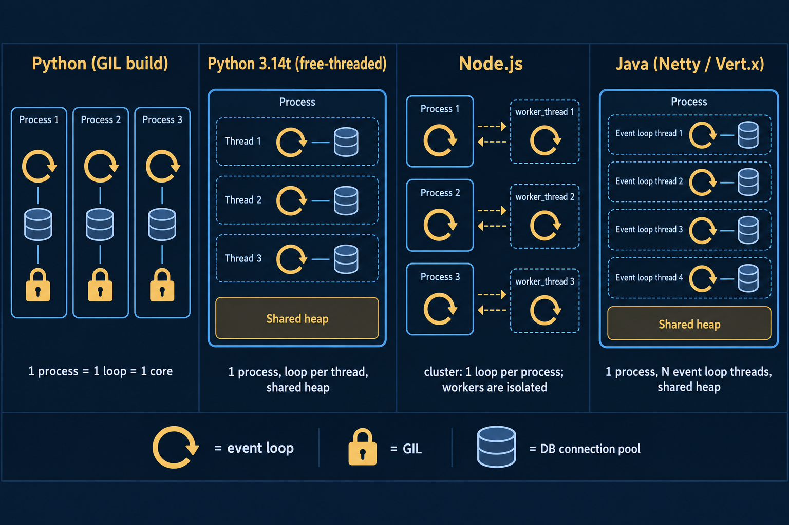

## 들어가며: 어디선가 봤었는데...

파이썬을 처음 배우고 Django로 비동기를 공부하던 2021년쯤 한국어 블로그 글을 하나 읽고 다음과 같이 기억하고 있었습니다.

> Python의 비동기는 GIL 때문에 JS처럼 진짜 비동기가 아니라 비동기처럼 동작하는 것이다. psycopg나 asyncpg로 비동기 DB 커넥션 풀을 써도 내부에 동기 싸이클이 있어서 병목이 되고, 그래서 웹에서는 Java를 쓴다.

비동기라는 개념을 처음 배우던 시절에 봤던 한국 블로그 포스팅이었는데 이벤트 루프에 대한 내용까지 시각화가 아주 잘 되어 있던 좋은 글이었습니다. 지금 시점에선 못찾는게 너무 아쉬웠던 글이었습니다.

논지가 비슷한 영어 글로는 Cal Paterson의 [Async Python is not faster](https://calpaterson.com/async-python-is-not-faster.html)(2020)와 SQLAlchemy 저자 Mike Bayer의 [Asynchronous Python and Databases](https://techspot.zzzeek.org/2015/02/15/asynchronous-python-and-databases/)(2015)가 있습니다.

이 기억을 바탕으로 파이썬에서의 이벤트 루프와 비동기, 그리고 비동기 DB 커넥션 등에 대해 다루고자 합니다. 이 글은 FastAPI나 Django로 작은 서비스를 한 번쯤 만들어 본 분을 독자로 생각하고 썼습니다. 그래서 결론을 적기 전에, 글 전체에서 계속 쓰는 용어 세 가지를 먼저 풀어 두겠습니다.

- **이벤트 루프**: 기다릴 일이 생기면 다른 작업으로 넘어가고, 준비된 작업을 돌아가며 실행하는 반복문입니다. asyncio는 이 반복문을 스레드 하나에서 돌립니다.
- **GIL**(Global Interpreter Lock): 한 프로세스 안에서 한 번에 한 스레드만 Python 코드를 실행하게 하는 자물쇠입니다.
- **비차단(non-blocking) I/O**: 데이터가 아직 오지 않았으면 기다리지 않고 바로 돌아오는 입출력 방식입니다. 프로그램은 그동안 다른 일을 하다가, 운영체제가 준비됐다고 알려 주면 그때 데이터를 읽습니다.

<br>

비동기를 처음 배우던 시절 저는 GIL과 asyncio 이벤트 루프가 강한 연관성이 있다고 이해했습니다. GIL 때문에 파이썬의 asyncio는 진짜 비동기 액션을 할 수 없다라고 잘못 이해했는데, 결론부터 적으면 다음과 같습니다:

- asyncio의 이벤트 루프는 한 스레드에서 돌기 때문에 GIL을 두고 경쟁할 상대가 없습니다. 네트워크 소켓 대기는 3.4부터 OS 수준의 비차단 I/O이므로, GIL은 비동기 I/O를 ==가짜로 만들지 않습니다==.
- GIL이 실제로 막는 것은 ==병렬성==, 즉 여러 코어에서 Python 코드를 동시에 실행하는 능력입니다. GIL 빌드에서는 CPU 작업을 스레드로 넘겨도 한 번에 한 스레드만 Python 코드를 실행하므로, 프로세스 하나가 Python 코드 실행에 쓰는 코어는 하나뿐입니다.
- 3.14가 바꾼 것도 이 병렬성입니다. 기본 빌드에는 GIL이 그대로 있고, GIL 없는 선택형 free-threaded 빌드가 공식 지원으로 승격됐습니다. asyncio는 그 빌드에서 스레드마다 이벤트 루프를 돌릴 때 스레드 수에 따라 선형으로 확장되도록 바뀌었습니다.
- 비동기 DB 드라이버에서 일반적인 쿼리의 소켓 대기는 이벤트 루프에 양보합니다. 다만 연결 생성과 결과 처리에는 별도 비용이 있습니다.
- 그래도 직렬로 처리되는 구간은 남습니다. 루프 스레드에서 도는 파이썬 CPU 처리, 일반 모드에서 한 커넥션의 작업이 직렬화되는 libpq(PostgreSQL이 제공하는 공식 C 클라이언트 라이브러리)·드라이버 관례, 그리고 GIL 빌드에서 프로세스 하나가 코어 하나만 쓴다는 제약입니다.

---

## asyncio 이벤트 루프가 한 바퀴 도는 과정

**이 절에서 확인할 질문**: asyncio는 DB 응답처럼 시간이 걸리는 I/O를 기다리는 동안 실제로 무엇을 하고 있는가?

asyncio의 이벤트 루프는 한 스레드에서 모든 콜백과 Task를 실행합니다. 여기서 Task는 `async def`로 만든 코루틴을 루프가 실행할 수 있게 감싼 작업 단위입니다.

한 Task가 실행되는 동안 같은 스레드의 다른 Task는 실행되지 않습니다. Task가 `await`에서 중단되어야 루프가 다음 Task로 넘어갑니다.

비유하자면 이벤트 루프는 손님 여러 명을 혼자 응대하는 점원과 비슷합니다. 점원은 주방에서 음식이 나오기를 기다리는 동안 계산대 앞에 멈춰 서 있지 않고, 그사이에 다음 손님의 주문을 받습니다.

쉽게 말하면 루프는 "준비된 소켓이 있는지 운영체제에 묻고, 준비된 작업만 실행하는 일"을 계속 반복합니다. 아래 단계에 나오는 ready 큐는 지금 바로 실행할 콜백을 모아 둔 목록이고, 타이머 힙은 정해진 시각에 실행할 콜백을 모아 둔 곳입니다. 이런 반복 작업이 마치 사이클로 표현할 수 있어 마치 이 포스팅의 썸네일 이미지가 연상될 수 있습니다.

이 한 바퀴를 구현한 `BaseEventLoop._run_once`는 다음 순서로 진행됩니다.

1. 타이머 힙에서 취소된 타이머를 정리합니다.
2. select 타임아웃을 계산합니다. ready 큐에 콜백이 있으면 0, 없으면 가장 이른 타이머까지 남은 시간이고, 타이머도 없으면 무기한입니다.
3. `self._selector.select(timeout)`로 I/O를 폴링하고, 준비된 소켓의 콜백을 ready 큐에 넣습니다.
4. 시각이 된 타이머를 ready 큐로 옮깁니다.
5. ==이 시점에 ready 큐에 있던 콜백만== 실행합니다. 실행 중에 새로 예약된 콜백은 다음 바퀴에서 실행됩니다.



/// caption
`SelectorEventLoop`에서 `_run_once`가 한 바퀴 도는 실제 코드 순서입니다. 소스 주석에 따르면 콜백을 실제로 호출하는 곳은 마지막 단계뿐입니다.
///

3단계의 selector는 운영체제의 epoll이나 kqueue를 감싼 객체입니다. epoll(Linux)과 kqueue(macOS, BSD)는 여러 소켓 중 어느 것이 준비됐는지 운영체제가 한 번에 알려 주는 기능입니다.

`selectors.DefaultSelector`는 kqueue, epoll, devpoll, poll, select 순서로 사용할 수 있는 것을 고릅니다. `SelectorEventLoop`는 소켓을 `setblocking(False)`로 바꿔서 비차단 소켓으로 다룹니다.

Windows의 기본 루프는 3.8부터 IOCP 기반 `ProactorEventLoop`입니다.

대기 중인 스레드는 커널의 `epoll_wait`나 `kevent`에서 잠들 뿐, 소켓마다 스레드를 붙잡지 않습니다. 즉 asyncio의 I/O 대기는 흉내 낸 비동기가 아니라 OS 수준의 비차단 I/O 다중화입니다.

예외도 있습니다. DNS 조회(도메인 이름을 IP 주소로 바꾸는 일)를 맡는 `loop.getaddrinfo()`는 동기 `socket.getaddrinfo`를 기본 스레드 풀에서 실행합니다.

DB 드라이버가 IP가 아닌 호스트 이름을 쓰면 연결 단계에서 DNS 조회가 들어갑니다. 네트워크 소켓 대기는 OS 비차단 I/O이지만, 호스트 이름을 IP로 바꾸는 DNS 조회 `getaddrinfo는 POSIX에 비동기 버전이 없는 블로킹 함수입니다. 그래서 asyncio는 이걸 스레드 풀에서 돌립니다.

디스크 파일은 `add_reader`로 감시할 수 없어서 `asyncio.to_thread`로 넘겨야 합니다. `add_reader`는 파일 디스크립터(운영체제가 열린 파일이나 소켓에 붙이는 번호)가 읽기 가능해지면 콜백을 부르도록 루프에 등록하는 함수입니다.

따라서 asyncio에서 DNS 조회는 `loop.getaddrinfo()`가 기본 executor에서 처리하고, 디스크 파일 I/O는 `asyncio.to_thread`로 넘긴 스레드가 처리합니다.

**요약**: asyncio는 I/O를 기다리는 동안 스레드를 멈춰 세우지 않고, 운영체제에 준비된 소켓을 물어본 뒤 준비된 작업만 실행합니다.

---

## Node.js와 비교

**이 절에서 확인할 질문**: Node.js의 비동기는 asyncio와 다른 방식으로 I/O를 기다리는가?

저는 "JS는 브라우저 엔진 기반이라 진짜 비동기"라고 막연히 생각했습니다. 그런데 Node.js가 이벤트 루프와 비동기 I/O에 쓰는 C 라이브러리인 libuv의 문서를 보니 구조가 asyncio와 거의 같았습니다.

libuv는 네트워크를 비차단 소켓과 epoll/kqueue/IOCP로 처리합니다. 비동기 `fs` API와 `dns.lookup()`은 기본 4개짜리 libuv 스레드 풀에서 실행합니다.

반면 `dns.resolve*()`는 스레드 풀을 쓰지 않고 DNS 서버에 네트워크로 직접 질의합니다. JS 실행 자체도 단일 스레드입니다.

| 항목                     | Python asyncio                             | Node.js (libuv)                                                    |
| ------------------------ | ------------------------------------------ | ------------------------------------------------------------------ |
| 사용자 코드 실행 스레드  | 루프당 1개                                 | 1개                                                                |
| 네트워크 I/O             | 비차단 소켓 + kqueue/epoll, Windows는 IOCP | 비차단 소켓 + epoll/kqueue/event ports/IOCP                        |
| DNS 조회                 | `loop.getaddrinfo()`는 기본 executor       | `dns.lookup()`은 libuv 스레드 풀, `dns.resolve*()`는 네트워크 질의 |
| 파일 I/O                 | 내장 API 없음, 스레드로 넘김               | 비동기 `fs` API는 libuv 스레드 풀                                  |
| CPU 작업이 루프를 막는가 | 막음                                       | 막음                                                               |

V8은 JS를 실행하는 엔진이고, Node의 I/O 비동기성은 libuv가 제공합니다. 그래서 "브라우저 엔진이라 진짜 비동기"라는 설명은 원인을 잘못 짚은 것이었습니다.

그럼에도 Node가 더 비동기답게 느껴지는 이유는 Node는 표준 I/O API가 처음부터 비동기였기 때문에 원래 근본 비동기 맛이 났기 때문입니다.

반면 Python은 동기 API가 기본이라, `requests`나 동기 DB 드라이버를 코루틴 안에서 무심코 호출하면 루프 전체가 멈춥니다.

**요약**: Node.js와 asyncio는 같은 방식으로 I/O를 기다리며, 체감 차이는 동기 API가 기본인 Python 생태계에서 생깁니다.

---

## GIL은 비동기를 가짜로 만드는가

**이 절에서 확인할 질문**: GIL은 asyncio를 어떤 구성으로 돌릴 때 병목이 되는가?

GIL은 한 번에 한 스레드만 Python 바이트코드를 실행하게 하는 장치입니다. 바이트코드는 인터프리터가 Python 소스를 실행하기 쉽게 바꾼 명령어입니다.

표준 라이브러리와 대부분의 C 드라이버는 블로킹 I/O를 기다리는 동안 GIL을 놓습니다. 블로킹 I/O는 데이터가 올 때까지 호출한 스레드를 멈춰 세우는 입출력입니다.

GIL 때문에 Python 비동기는 진짜가 아니라는 설명을 자주 봅니다. 그런데 하나씩 따져 보니 이 질문에는 한 가지 답을 낼 수 없었습니다. GIL이 비동기를 가짜로 만드는지는 ==루프를 몇 개, 어디에 두느냐==에 따라 답이 달라집니다.

그래서 아래에서는 루프 하나만 두는 구성, 스레드마다 루프를 두는 구성, DB 커넥션 수만큼 스레드 풀을 두는 구성을 차례로 살펴보겠습니다.

### 루프 하나만 두는 구성

FastAPI 앱을 uvicorn 워커 하나로 띄우면, 프로세스 안에서는 이벤트 루프 하나가 스레드 하나에서 돕니다. 이 구성에는 다른 스레드가 없으므로 GIL을 두고 경쟁할 상대도 없습니다.

루프가 소켓을 기다릴 때는 커널의 `epoll_wait`나 `kevent`에서 GIL을 놓은 채 잠듭니다. 그래서 루프 하나의 I/O 처리량은 GIL과 거의 무관합니다.

CPU 바운드 코드는 이 구성에서도 루프를 멈춥니다. CPU 바운드 코드는 입출력을 기다리는 시간보다 계산하는 시간이 대부분인 코드를 말합니다.

하지만 이때 루프가 멈추는 원인은 GIL이 아니라, 루프가 스레드 하나에서 돈다는 구조입니다. Python 공식 문서도 1초짜리 계산을 직접 호출하면 모든 Task와 I/O가 1초 늦어진다고 설명합니다.

따라서 ==루프 하나짜리 구성에서**는** "GIL 때문에 비동기가 가짜"라는 설명은 틀렸습니다.==

### 스레드마다 루프를 하나씩 두는 구성

이번에는 한 프로세스 안에 스레드를 여러 개 만들고, 스레드마다 이벤트 루프를 하나씩 돌리는 구성을 생각해 보겠습니다. 예를 들어 DB 커넥션 수만큼 스레드를 만들고, 스레드마다 루프와 커넥션을 하나씩 맡기는 방식입니다. 이 구성은 Java 생태계에서 많이 사용되는 방식입니다.

각 루프가 `epoll_wait`에서 잠들 때는 GIL을 놓으므로, 여러 루프의 I/O 대기는 실제로 겹칩니다. 여기까지는 문제가 없습니다.

문제는 루프가 깨어난 뒤에 생깁니다. 콜백을 실행하는 일, DB가 보낸 결과 행을 Python 객체로 바꾸는 디코딩, ORM이 그 값으로 모델 객체를 만드는 일은 모두 GIL을 쥐어야 실행할 수 있는 코드입니다.

그래서 루프 N개가 GIL 하나를 차례로 기다립니다. 스레드를 몇 개 두든, 프로세스 전체가 Python 코드를 처리하는 능력은 코어 하나만큼입니다.

대기 비용도 따로 붙습니다. GIL 빌드는 기본 5ms 간격으로 스레드 사이에서 GIL을 넘기므로, 깨어난 루프가 GIL을 다시 얻기까지 기다리는 시간이 꼬리 지연으로 쌓일 수 있습니다. 꼬리 지연은 드물게 나오는 가장 느린 응답의 지연 시간입니다.

Quansight의 Kumar Aditya가 공개한 벤치마크가 이 차이를 수치로 보여 줍니다. 6코어 12스레드 Windows 환경에서 스레드마다 루프를 둔 TCP 처리량은 워커 1개일 때 276MB/s였습니다.

워커를 12개로 늘리자 GIL 빌드는 698MB/s로, 워커 1개일 때의 2.5배 정도에 그쳤습니다. GIL이 없는 free-threaded 빌드는 1924MB/s로 약 7배까지 올라갔습니다.

==이 구성에서는 "GIL 때문에 병목이 생긴다"는 말이 맞습니다.== 특히 DB I/O는 응답을 받은 뒤 결과 행을 변환하는 CPU 비용이 붙기 때문에, 루프가 깨어날 때마다 GIL을 기다리는 구간이 더 두드러집니다.

### DB 커넥션 수만큼 스레드 풀을 두는 구성

psycopg2 같은 동기 드라이버를 asyncio에서 쓰려면 `run_in_executor`나 `asyncio.to_thread`로 호출을 스레드 풀에 넘깁니다. 스레드 풀은 미리 만들어 둔 스레드 여러 개에 작업을 나눠 맡기는 장치이고, 이때는 보통 커넥션 수만큼 스레드를 둡니다.

psycopg2는 libpq가 응답을 기다리는 동안 GIL을 놓습니다. 그래서 커넥션 수만큼 DB 응답 대기가 겹칩니다.

하지만 응답이 돌아와 결과를 Python 튜플로 변환하는 순간부터는 다시 GIL이 필요한 직렬 구간입니다. 앞의 구성과 마찬가지로, 결과 변환과 그 뒤의 Python 처리는 스레드 수와 관계없이 한 번에 한 스레드씩 실행됩니다.

순수 Python CPU 작업을 스레드 풀에 넘기는 경우도 같습니다. 루프는 멈추지 않지만, GIL 빌드에서는 전체 처리량이 늘지 않습니다.

asyncpg나 psycopg 3의 `AsyncConnection` 같은 비동기 드라이버는 소켓 대기를 루프에 맡기므로 이런 스레드 풀이 필요 없습니다. 대신 결과 디코딩이 루프 스레드에서 실행된다는 점은 그대로 남습니다.

### Python에서 프로세스를 늘리는 이유

그래서 Python 웹 서비스는 "스레드마다 루프"가 아니라 "프로세스마다 루프 하나"로 구성하는 것이 관행입니다. gunicorn이나 uvicorn 워커 프로세스를 코어 수만큼 띄우고, 커넥션 풀도 프로세스마다 따로 둡니다.

프로세스는 각자 자기 GIL을 가지므로, 이렇게 구성하면 루프마다 코어 하나를 온전히 쓸 수 있습니다.

3.14의 free-threaded 빌드(3.14t)가 바꾸는 지점이 바로 스레드마다 루프를 두는 구성입니다. 이 빌드에는 GIL이 없어서, 한 프로세스 안의 루프 여러 개가 여러 코어에서 동시에 Python 코드를 실행합니다.

다만 드라이버의 C 확장이 free-threading 호환을 선언해야 한다는 조건이 붙습니다. 선언하지 않은 확장을 import하면 GIL이 다시 켜집니다. 드라이버별 지원 상태는 뒤의 "DB 비동기 엔진을 고를 때 생긴 차이" 절에서 다룹니다.

### Node.js와 다른 점

Node.js에는 GIL이 없습니다. 여러 JS 스레드가 하나의 힙을 공유하는 모델 자체가 없기 때문입니다. 힙은 프로그램이 만든 객체가 저장되는 메모리 영역입니다.

`worker_threads`로 만든 스레드는 각자 독립된 V8 isolate와 이벤트 루프를 가지며, 다른 스레드와 JS 객체를 공유하지 않고 메시지로 데이터를 주고받습니다. 여러 코어를 쓰려면 보통 `cluster`로 프로세스를 여러 개 띄웁니다.

즉 여러 스레드가 같은 힙 위에서 루프를 돌리거나 스레드 풀로 DB 작업을 넘기는 혼합 구성은 Node에서는 애초에 선택지가 아닙니다. Python에는 그 선택지가 있지만, GIL 빌드에서는 Python 코드 실행이 코어 하나로 줄어듭니다. 이것이 두 런타임의 실제 차이입니다.

libuv 스레드 풀이나 GIL을 놓는 C 확장처럼 네이티브 코드가 처리하는 작업은 양쪽 모두 병렬로 실행됩니다.

3.14에 들어온 PEP 734 서브인터프리터는 인터프리터마다 상태를 따로 두고 객체를 거의 공유하지 않으므로, 오히려 `worker_threads`에 가깝습니다. 반면 free-threaded 빌드의 스레드는 힙을 공유한 채 병렬로 실행되므로, `worker_threads`보다 공유 범위가 넓은 모델입니다.

### 참고: JIT은 별개의 기능입니다

참고로 3.13에 들어온 JIT(PEP 744)은 인터프리터의 해석 오버헤드를 줄이려고 코드를 실행 중에 기계어로 바꾸는 기능입니다. 구체적으로는 마이크로옵 트레이스를 copy-and-patch 방식으로 기계어로 바꿉니다.

JIT은 Python 코드의 실행 속도를 바꿀 뿐 이벤트 루프가 소켓을 기다리는 방식과는 관계가 없으며, 3.15.0까지 실험적 기능으로 남아 있습니다.

GIL 제거와 JIT이 서로 별개의 기능이라는 점은 3.14 What's New에 적힌 다음 문장으로도 확인할 수 있습니다.

> Free-threaded builds do not support JIT compilation.

**요약**: GIL은 루프 하나의 I/O 대기를 가짜로 만들지 않지만, 루프나 스레드 풀을 여러 스레드에 나눠 두는 순간 Python 코드 실행을 코어 하나로 제한합니다. DB I/O에서 Python이 골치 아프다는 인상은 이 구성에서 나옵니다.

---

## 비동기 DB 드라이버는 내부에서 무엇을 하는가

**이 절에서 확인할 질문**: 비동기 DB 드라이버는 DB 응답을 기다리는 동안 이벤트 루프를 막는가?

먼저 용어 두 가지를 정리하겠습니다. libpq는 PostgreSQL이 제공하는 공식 C 클라이언트 라이브러리이고, psycopg2와 psycopg 3이 이 라이브러리 위에서 동작합니다.

커넥션 풀은 DB 연결을 미리 여러 개 만들어 두고, 요청이 올 때마다 빌려 쓰고 돌려주는 장치입니다.

"내부에 동기 싸이클이 있다"는 말이 사실인지는 드라이버마다 다릅니다.

**psycopg2** 기본 모드는 libpq의 블로킹 호출을 GIL을 놓은 채 기다립니다. 스레드 서버에서는 문제가 없지만, 코루틴 안에서 그대로 부르면 루프가 멈추므로 스레드 풀이 필요합니다.

다만 psycopg2에는 `async_=True` 모드(옛 표기 `async=1`)와 `poll()` 상태 머신도 있습니다. aiopg는 이를 `add_reader`/`add_writer`에 연결해 스레드 풀 없이 asyncio에 얹었습니다.

psycopg 3의 **`AsyncConnection`** 은 한 줄로 말하면, 기다려야 할 때마다 소켓을 이벤트 루프에 맡기고 제어를 돌려주는 방식입니다.

자세히 보면 `AsyncConnection`은 libpq 비동기 API(`PQsendQuery`, `PQisBusy`, `PQgetResult` 등)를 부르는 제너레이터로 통신하다가, 기다려야 할 때 `Wait` 상태를 yield합니다. 제너레이터는 `yield`에서 실행을 멈췄다가 값을 받으면 이어서 실행하는 Python 함수입니다.

그러면 `wait_async()`가 소켓 fd를 `loop.add_reader`/`add_writer`로 등록하고 Future를 await합니다. Future는 나중에 채워질 결과를 나타내는 객체이고, 결과가 채워지면 그 Future를 await하던 코루틴이 다시 실행됩니다.



/// caption
psycopg 3 `AsyncConnection`으로 쿼리를 한 번 실행할 때 이벤트 루프를 오가는 과정
///

다음 코드는 psycopg 3의 `AsyncConnection`으로 쿼리 하나를 실행하는 최소 예시입니다.

```python
import asyncio
import sys

import psycopg

async def main():
    async with await psycopg.AsyncConnection.connect("postgresql://localhost/test") as conn:
        async with conn.cursor() as cur:
            await cur.execute("SELECT %s::int + 1", (41,))
            print(await cur.fetchone())  # (42,)

if sys.platform == "win32":
    # psycopg 3의 비동기 모드는 Windows에서 SelectorEventLoop가 필요합니다
    asyncio.set_event_loop_policy(asyncio.WindowsSelectorEventLoopPolicy())

asyncio.run(main())
```

로컬 PostgreSQL에 `test` 데이터베이스가 있다면 실행 결과로 `(42,)`가 출력되고, `await`마다 위 다이어그램의 과정이 일어납니다.

**asyncpg**는 한 줄로 말하면, libpq를 쓰지 않고 PostgreSQL과 통신하는 규칙(프로토콜)을 직접 구현한 드라이버입니다.

구체적으로는 PostgreSQL 바이너리 프로토콜을 Cython으로 구현한 `asyncio.Protocol`입니다. Cython은 Python과 비슷한 문법으로 C 확장을 작성하는 도구입니다.

소켓은 asyncio 트랜스포트가 다루고, 수신 데이터는 `data_received()`에서 Cython 코드가 루프 스레드 위에서 파싱합니다.

한 커넥션에서 작업이 겹치면 예외가 발생하므로, 커넥션당 한 작업이라는 규칙이 코드에 그대로 드러납니다.

다음 코드는 풀에서 서로 다른 커넥션을 빌려 쿼리를 동시에 실행하는 경우와, 커넥션 하나에 쿼리 두 개를 겹쳐 보내는 경우를 비교합니다.

```python
import asyncio
import asyncpg

DSN = "postgresql://localhost/test"

async def main():
    pool = await asyncpg.create_pool(DSN, min_size=2, max_size=10)
    async with pool:
        # 쿼리마다 풀에서 서로 다른 커넥션을 빌리므로 동시에 진행됩니다
        print(await asyncio.gather(*(pool.fetchval("SELECT $1::int FROM pg_sleep(1)", i) for i in range(5))))

    conn = await asyncpg.connect(DSN)
    # 같은 커넥션에 쿼리 두 개를 겹쳐 보내면 두 번째 쿼리가 거부됩니다
    # return_exceptions=True로 첫 쿼리가 끝날 때까지 기다린 뒤 커넥션을 닫습니다
    results = await asyncio.gather(
        conn.fetchval("SELECT 1 FROM pg_sleep(1)"),
        conn.fetchval("SELECT 2"),
        return_exceptions=True,
    )
    print(repr(results[1]))  # InterfaceError('cannot perform operation: another operation is in progress')
    await conn.close()

asyncio.run(main())
```

실행하면 첫 번째 `print`는 1초짜리 쿼리 다섯 개를 동시에 처리한 결과인 `[0, 1, 2, 3, 4]`를 출력하고, 두 번째 `print`는 주석에 적은 `InterfaceError`를 출력합니다.

**SQLAlchemy asyncio 확장**은 한 줄로 말하면, 기존의 동기 코드를 그대로 두고 비동기 드라이버 위에서 돌리기 위해 greenlet을 쓰는 방식입니다. greenlet은 함수 실행을 중간에 멈췄다가 이어 갈 수 있게 하는 경량 스레드 비슷한 도구입니다.

자세히 보면 동기 Core/ORM 코드는 greenlet 안에서 실행됩니다. 드라이버 호출 지점의 `await_only(awaitable)`가 부모 greenlet으로 전환해 awaitable을 넘기면, 부모 쪽 `greenlet_spawn`이 실제로 await한 뒤 결과를 들고 돌아옵니다.

공식 문서도 스레드 executor를 쓰지 않는다고 밝힙니다. 동기 코드가 돌기는 하지만 같은 루프 스레드에서 돌다가 I/O 지점에서 양보하며, 이때 드는 비용은 greenlet 전환과 ORM의 파이썬 연산입니다.

이 브리지 바깥에서 I/O가 일어나면 `MissingGreenlet` 에러가 납니다. FastAPI에서 이 에러가 반복되는 이유와 상황별 해결은 [SQLAlchemy AsyncSession에서 MissingGreenlet 에러가 반복되는 이유](https://bnbong.com/blog/20261015-sqlalchemy-missing-greenlet/)에서 따로 다뤘습니다.

다음 코드는 asyncpg를 드라이버로 쓰는 SQLAlchemy 비동기 엔진에서 쿼리 하나를 실행합니다.

```python
import asyncio
from sqlalchemy import text
from sqlalchemy.ext.asyncio import create_async_engine

async def main():
    engine = create_async_engine("postgresql+asyncpg://localhost/test", pool_size=5)
    async with engine.connect() as conn:
        result = await conn.execute(text("SELECT 1"))
        print(result.scalar_one())  # 1
    await engine.dispose()

asyncio.run(main())
```

실행하면 `1`이 출력됩니다. 코드에는 greenlet이 드러나지 않지만, `conn.execute` 내부에서 앞에서 설명한 greenlet 전환이 일어납니다.

반대로 **aiosqlite**는 커넥션마다 전용 스레드를 두고 표준 `sqlite3` 동기 호출을 순서대로 실행합니다. 따라서 "내부가 동기"라는 설명은 이 드라이버에 한해서는 맞습니다.

**요약**: asyncpg, psycopg 3, SQLAlchemy asyncio 확장은 DB 응답을 기다리는 동안 루프에 양보하며, 내부가 실제로 스레드 기반인 드라이버는 aiosqlite입니다.

---

## "동기 싸이클"의 실체

**이 절에서 확인할 질문**: 비동기 드라이버를 써도 직렬로 처리되는 구간은 어디인가?

여기서 직렬 구간은 한 작업이 끝나야 다음 작업이 시작되는 구간을 말합니다. 비동기 드라이버를 써도 이런 구간이 남는 지점을 표로 정리했습니다.

| 지점                        | 실제로 있는가      | 설명                                                                                                                                                                                                                                                   |
| --------------------------- | ------------------ | ------------------------------------------------------------------------------------------------------------------------------------------------------------------------------------------------------------------------------------------------------ |
| (a) DNS 조회                | 있음               | asyncio의 `getaddrinfo`는 스레드 풀에서 블로킹 호출을 실행합니다. aiopg 같은 libpq 비동기 연결은 `hostaddr` 없이 호스트 이름을 쓰면 연결 단계에서 블록할 수 있습니다. 풀을 쓰면 새 커넥션을 만들 때만 발생합니다.                                      |
| (b) 결과 디코딩·ORM 처리    | 있음               | asyncpg의 Cython 디코딩, psycopg 3의 로더, SQLAlchemy ORM의 객체 생성이 모두 루프 스레드를 점유합니다.                                                                                                                                                 |
| (c) 커넥션 풀의 락          | 사실상 없음        | psycopg_pool, asyncpg Pool, SQLAlchemy `AsyncAdaptedQueuePool`의 대기 경로는 모두 asyncio Lock/Queue 기반입니다. SQLAlchemy 풀에는 overflow 카운터용 짧은 내부 mutex가 있지만 대기 중 루프를 막지는 않습니다. 실제 제약은 풀 크기입니다.               |
| (d) 한 커넥션의 작업 직렬화 | 일반 모드에서 있음 | libpq 일반 모드는 `PQgetResult`가 NULL을 반환할 때까지 같은 커넥션에서 다음 `PQsendQuery`를 허용하지 않고, asyncpg도 커넥션당 한 작업만 허용합니다. 파이프라인 모드(psycopg 3 + libpq 14 이상)는 왕복 대기를 줄이지만 서버는 보낸 순서대로 실행합니다. |
| (e) GIL과 스레드 오프로딩   | 부분적으로 있음    | C 드라이버는 대기 중 GIL을 놓으므로 I/O 대기는 겹칩니다. 그러나 결과 변환 같은 파이썬 코드 구간은 GIL 빌드에서 한 번에 한 스레드만 실행됩니다.                                                                                                         |

결국 "동기 싸이클"의 실체는 ==I/O 대기가 아니라 루프 스레드에서 직렬로 도는 파이썬 CPU 처리==로 보입니다. Bayer의 2015년 프로파일에서도 실행 시간의 약 2/3가 네트워크 I/O가 아니라 파이썬 처리였습니다.

**요약**: 비동기 드라이버에서 남는 직렬 구간은 주로 결과 디코딩과 ORM 처리 같은 파이썬 CPU 작업과, 한 커넥션에서 한 번에 한 작업만 하는 규칙입니다.

---

## Python 3.13, 3.14, 3.15에서 실제로 바뀐 것

**이 절에서 확인할 질문**: 3.13부터 3.15까지 GIL과 asyncio에서 실제로 바뀐 것은 무엇인가?

**Python 3.13** (2024-10)에는 PEP 703의 free-threaded 빌드(`python3.13t`)와 PEP 744의 JIT이 모두 실험적으로 들어왔습니다. free-threaded 빌드는 GIL 없이 빌드한 Python으로, 여러 스레드가 동시에 Python 코드를 실행할 수 있습니다.

이때 asyncio는 free-threaded 빌드에서 돌기는 했지만, gh-128002가 정리한 것처럼 전역 dict/set에 의존해 성능이 나빴습니다. 또한 Task 취소 카운터가 원자적이지 않아서, 여러 스레드가 동시에 값을 바꾸면 값이 어긋날 수 있었습니다.

**Python 3.14** (2025-10-07)에서는 PEP 779에 따라 free-threaded 빌드가 "공식 지원, 단 선택 사항"으로 올라갔고, 단일 스레드 성능 손실은 대략 5~10%로 줄었습니다. 기본 빌드에는 여전히 GIL이 있으며 `python3.14t`를 따로 설치해야 합니다.

asyncio는 Task 목록을 스레드별 연결 리스트로 바꾸면서 free-threaded 빌드를 1급으로 지원하게 됐습니다. What's New는 여러 스레드의 이벤트 루프가 "scaling linearly with the number of threads"한다고 설명합니다.

Task 트리를 보여 주는 `python -m asyncio ps`/`pstree`도 이때 추가됐습니다.

PEP 734의 `concurrent.interpreters`도 3.14에 들어왔습니다. 이 기능은 한 프로세스에서 여러 인터프리터를 실행하는 것으로, free-threading과는 별개입니다.

Quansight의 Kumar Aditya가 공개한 벤치마크(6코어 12스레드 Windows)에서 TCP 처리량은 워커 1개일 때 276MB/s였고, 워커 12개일 때 GIL 빌드 698MB/s, free-threaded 빌드 1924MB/s였습니다.

아래 그림은 GIL 빌드와 free-threaded 빌드에서 여러 코어를 쓰는 구성을 비교합니다.



/// caption
두 구성 모두 루프 하나가 커넥션 풀 하나를 소유합니다. 바뀌는 것은 루프를 담는 단위가 프로세스인지 스레드인지입니다.
///

**Python 3.15.0** (2026-10-09)은 현재 최신 안정판입니다. JIT은 "Upgraded experimental JIT compiler"라는 제목대로 여전히 실험적이며, pyperformance 기하평균으로 x86-64 Linux에서 7~8% 빨라졌다고 보고합니다.

기본 빌드를 GIL 없는 빌드로 바꾸는 Phase III는 제가 확인한 범위에서 아직 시점이 정해지지 않았습니다.

정리하면 3.14는 비동기를 바꾼 것이 아니라 병렬성을 열었습니다. 3.14는 선택형 free-threaded 빌드를 공식 지원 단계로 올렸을 뿐이고, 기본 빌드의 GIL은 그대로입니다.

비동기 I/O는 3.4부터 이미 OS 수준의 비차단 I/O였습니다. 3.14에서 새로 가능해진 것은 한 프로세스 안에서 스레드마다 이벤트 루프를 하나씩 돌리고, 그 루프들이 여러 코어에서 동시에 Python 코드를 실행하는 구성입니다.

**요약**: 3.14는 선택형 free-threaded 빌드로 멀티코어 병렬성을 열었으며, 기본 빌드와 비동기 I/O의 동작 방식은 바뀌지 않았습니다.

---

## DB 비동기 엔진을 고를 때 생긴 차이

**이 절에서 확인할 질문**: free-threaded 빌드에서 스레드마다 이벤트 루프를 돌리려면 드라이버와 서버가 무엇을 갖춰야 하나?

스레드당 이벤트 루프 구성을 쓰려면 드라이버의 C 확장이 free-threading 호환을 선언해야 합니다. 선언하지 않은 확장을 import하면 GIL이 다시 켜집니다.

아래 표에서 휠(wheel)은 미리 빌드해 배포하는 Python 패키지 파일이고, `cp314t`처럼 끝에 `t`가 붙은 휠이 free-threaded 빌드용입니다. 2026-10-14 기준 상태는 다음과 같습니다.

| 패키지                   | free-threaded 지원 상태                                                                                                |
| ------------------------ | ---------------------------------------------------------------------------------------------------------------------- |
| asyncpg                  | 0.31.0(2025-11)에서 실험적 지원, 0.32.0(2026-10-06)은 `cp314t`/`cp315t` 휠 배포                                        |
| psycopg 3                | 추적 이슈 #1095가 열린 상태, 3.3.6 바이너리에 `t` 휠 없음. 메인테이너는 지원 완료를 선언할 때만 바이너리를 낸다고 밝힘 |
| SQLAlchemy               | 2.0.44(2025-10-10)에서 초기 지원, `t` 휠은 2.1 시리즈(2.1.4 기준 `cp314t`/`cp315t`)                                    |
| greenlet                 | 3.3.0(2025-12-04)에서 3.14 free-threaded 초기 지원, 이후 3.5.x에서 segfault·데드락 수정                                |
| uvloop, granian, asyncmy | `cp314t` 휠 있음                                                                                                       |

웹 서버 중에서는 Granian이 free-threaded 모드에서 워커를 스레드로 띄우고 스레드마다 이벤트 루프를 돌립니다. 다만 README는 이 기능이 실험적이며 운영 환경에서는 강하게 권장하지 않는다고 경고합니다.

asyncio의 Lock과 Queue는 스레드 간 동기화용이 아니므로, 커넥션 풀도 루프마다 따로 둬야 합니다.

바뀌지 않는 것도 있습니다. 한 루프 안의 파이썬 코드는 여전히 직렬이라, 큰 결과셋을 디코딩하는 동안 같은 루프의 다른 Task는 멈춥니다.

협력적 스케줄링의 꼬리 지연과, 일반 모드에서 한 커넥션의 작업이 직렬화되는 libpq·드라이버 관례도 그대로입니다. 여기서 협력적 스케줄링은 각 Task가 `await`에서 스스로 제어를 넘겨야 다른 Task가 실행되는 방식을 말합니다.

그리고 ==free-threaded Python, asyncio 웹 서버, DB 드라이버를 함께 측정한 1차 벤치마크는 아직 찾지 못했습니다.==

**요약**: 스레드당 루프 구성은 드라이버의 free-threading 호환 선언과 루프별 커넥션 풀이 필요하며, 지원 상태는 아직 패키지마다 다르고 상당 부분 실험적입니다.

---

## 그래서 웹에서는 Java를 써야 하는가

**이 절에서 확인할 질문**: 공개된 벤치마크 수치는 "웹에서는 Java를 쓴다"는 판단을 뒷받침하는가?

TechEmpower Framework Benchmarks Round 23(2025-02 공개, Intel Xeon Gold 6330 환경)의 원자료를 보겠습니다. TechEmpower가 2026-03-24에 프로젝트 종료를 발표했으므로 이것이 마지막 라운드입니다.

uvicorn raw와 FastAPI는 asyncpg 풀을 쓰고, FastAPI는 코어 수만큼 워커 프로세스를 띄운 구성입니다. Spring은 Spring MVC + 블로킹 JDBC입니다.

단위는 RPS(requests per second), 즉 초당 처리한 요청 수입니다. 괄호 안은 해당 테스트의 Python 최상위 구현입니다.

| 테스트    | vertx-postgres (Java) | Spring MVC + JDBC | Python 최상위           | FastAPI (Python) | Django ORM (Python) |
| --------- | --------------------- | ----------------- | ----------------------- | ---------------- | ------------------- |
| 단일 쿼리 | 1,315,264             | 205,876           | 256,513 (uvicorn raw)   | 163,894          | 43,670              |
| 20쿼리    | 88,709                | 31,593            | 38,385 (uvicorn raw)    | 37,254           | 3,878               |
| Fortunes  | 1,040,600             | 243,640           | 174,439 (fastwsgi-asgi) | 109,167          | 32,637              |

Java 리액티브 스택(Vert.x, Quarkus)은 Python 최상위보다 단일 쿼리와 Fortunes에서 5~6배 높으므로, Round 23의 이 구현 조합에서는 "Java가 빠르다"가 맞습니다.

그러나 Spring MVC + JDBC와 비교하면, Round 23의 이 구현 조합에서는 asyncpg 기반 raw Python이 단일 쿼리와 20쿼리에서 오히려 앞섭니다. Fortunes에서는 Spring이 약 1.4배 앞서고, Django ORM은 Spring의 1/5~1/8 수준입니다.

다만 비교 대상 사이에는 웹 서버, 프레임워크, ORM, 설정의 차이가 함께 섞여 있으므로 이 표만으로는 격차의 원인을 분리할 수 없습니다.

드라이버 안의 동기 싸이클이 격차의 원인이라는 설명은 이 수치로는 뒷받침되지 않으며, 원인을 확정하려면 프로파일링이 필요합니다.

Cal Paterson의 글에도 지금까지 유효한 교훈이 있습니다. Paterson의 벤치마크(4 vCPU, pgbouncer, aiopg)에서 P99 지연은 sync가 31 ~ 42ms, async가 75 ~ 364ms였습니다.

P99는 요청 100개를 빠른 순으로 줄 세웠을 때 99번째 요청이 걸린 시간으로, 꼬리 지연을 나타내는 대표 지표입니다.

aiopg를 썼다는 약점은 당시에도 지적받았습니다. 그래도 async가 자동으로 빨라지지 않는다는 점과, CPU를 오래 잡는 작업 하나가 다른 요청의 꼬리 지연을 키운다는 점은 여전히 맞습니다.

Tom Christie의 반론처럼 async는 "더 빠른 것"이 아니라, 동시 연결이 많을 때 "더 효율적인 것"으로 이해하는 편이 정확합니다.

**요약**: Round 23의 이 구현 조합에서 Java 리액티브 스택은 앞서지만 Spring MVC + JDBC는 asyncpg 기반 raw Python에 뒤지는 테스트도 있으며, 격차의 원인은 이 수치만으로 정할 수 없습니다.

## 네 가지 런타임 구성 한눈에 보기

지금까지 비교한 Python, Node.js, Java의 실행 구성을 그림 하나로 정리했습니다.


/// caption
원형 화살표는 이벤트 루프, 자물쇠는 GIL, 실린더는 DB 커넥션 풀입니다. Python GIL 빌드와 Node.js는 프로세스마다 루프 하나를 두고, Python 3.14t와 Java는 한 프로세스 안에서 힙을 공유하는 루프 스레드 여러 개를 둡니다.
///

Python GIL 빌드는 프로세스마다 루프 하나를 두고 프로세스 수로 코어를 채웁니다. Node.js도 `cluster`로 프로세스를 늘리고, `worker_threads`는 서로 격리된 채 메시지로만 통신합니다.

Java의 Netty나 Vert.x는 한 프로세스 안에서 이벤트 루프 스레드 여러 개가 힙을 공유하며 병렬로 돕니다. Python 3.14t의 스레드당 루프 구성이 바로 이 모델에 해당하고, 드라이버와 서버의 지원이 갖춰지는 중입니다.

---

## 마무리: 비동기 드라이버를 쓸 때 알아 둘 것

지금까지 확인한 내용을 흔한 오해와 실제 동작으로 나누어 정리했습니다.

| 흔한 오해                                           | 실제 동작                                                                                                                                                                          | 실무에서 의미하는 것                                                                                                                                                                                                           |
| --------------------------------------------------- | ---------------------------------------------------------------------------------------------------------------------------------------------------------------------------------- | ------------------------------------------------------------------------------------------------------------------------------------------------------------------------------------------------------------------------------ |
| Python 비동기는 JS처럼 진짜 비동기가 아니다         | asyncio와 Node.js 모두 비차단 소켓과 epoll/kqueue/IOCP 위의 단일 스레드 이벤트 루프이며, DNS 조회(`loop.getaddrinfo()`, `dns.lookup()`)와 파일 I/O는 둘 다 스레드 풀로 처리합니다. | 두 런타임의 차이는 I/O를 기다리는 방식이 아니라 생태계에 있습니다. Python에서는 동기 API가 기본이므로 비동기 라이브러리를 골라 써야 합니다.                                                                                    |
| GIL 때문에 asyncio는 진짜 비동기가 아니다           | 루프는 단일 스레드라 GIL을 두고 경쟁할 상대가 없고, 소켓 대기는 OS 수준의 비차단 I/O입니다.                                                                                        | 동기 드라이버를 코루틴 안에서 부르지 않는 것이 핵심이고, GIL은 CPU 병렬성 문제입니다. GIL 빌드에서는 CPU 작업을 스레드로 넘겨도 한 번에 한 스레드만 Python 코드를 실행합니다.                                                  |
| 비동기 커넥션 풀 내부에 동기 싸이클이 있어 병목이다 | asyncpg와 psycopg 3에서 일반적인 쿼리의 소켓 대기는 이벤트 루프에 양보합니다. 연결 생성과 결과 처리에는 별도 비용이 있고, aiosqlite는 실제로 전용 스레드 구조입니다.               | 직렬 구간은 루프 스레드의 파이썬 CPU 처리, 일반 모드에서 한 커넥션의 작업이 직렬화되는 libpq·드라이버 관례, GIL 빌드에서 프로세스 하나가 코어 하나만 쓴다는 제약입니다. 풀보다 결과 디코딩과 ORM 처리 비용을 먼저 봐야 합니다. |
| 웹에서는 Java를 써야 한다                           | TechEmpower R23의 이 구현 조합에서 Java 리액티브 스택은 Python 최상위보다 높지만, Spring MVC + JDBC 대비로는 수치가 받쳐 주지 않습니다.                                            | 구현마다 서버·프레임워크·ORM이 달라서 이 수치만으로 격차의 원인을 특정할 수는 없습니다. 언어를 바꾸기 전에 원인을 프로파일링으로 확인해야 합니다.                                                                              |
| 3.14에서 GIL이 해결되어 진짜 비동기가 됐다          | 3.14는 선택형 free-threaded 빌드를 공식 지원으로 올렸고, asyncio가 그 빌드를 1급으로 지원하게 됐습니다. 기본 빌드의 GIL은 그대로입니다.                                            | 열린 것은 비동기가 아니라 멀티코어 병렬성입니다. 스레드당 루프 구성은 드라이버와 서버의 지원이 아직 실험적입니다.                                                                                                              |

이 내용을 바탕으로, 실무에서는 다음 기준으로 드라이버와 구성을 고르려고 합니다.

- 동시 연결이 많고 I/O 대기가 긴 서비스에는 asyncpg나 psycopg 3 `AsyncConnection`을 쓰고, 동기 드라이버를 코루틴 안에서 호출하지 않습니다.
- 요청당 CPU 처리가 크다면 비동기 여부보다 ORM과 직렬화 비용을 먼저 측정합니다. GIL 빌드에서는 프로세스 수로 코어를 채웁니다.
- free-threaded 스레드당 루프 구성은 드라이버와 서버가 아직 실험적이므로, 운영에 쓰기 전에 직접 측정합니다.

비동기 I/O의 성능을 좌우하는 것은 GIL이 아니라, 루프 스레드에서 파이썬 CPU 처리가 얼마나 오래 실행되는지입니다. GIL이 제한하는 것은 병렬성이고, 비동기 드라이버에서 남는 직렬 구간의 실체는 루프 스레드에서 도는 파이썬 CPU 처리입니다.

---

## 참고 자료

**CPython과 PEP**

- PEP 703, Making the Global Interpreter Lock Optional in CPython: <https://peps.python.org/pep-0703/>
- PEP 703 수락 공지(운영위원회): <https://discuss.python.org/t/pep-703-making-the-global-interpreter-lock-optional-in-cpython-acceptance/37075>
- PEP 744, JIT Compilation: <https://peps.python.org/pep-0744/>
- PEP 779, Criteria for supported status for free-threaded Python: <https://peps.python.org/pep-0779/>
- What's New In Python 3.13: <https://docs.python.org/3.13/whatsnew/3.13.html>
- What's New In Python 3.14: <https://docs.python.org/3.14/whatsnew/3.14.html> (PEP 734 `concurrent.interpreters` 포함)
- What's New In Python 3.15: <https://docs.python.org/3.15/whatsnew/3.15.html>
- Python 3.15.0 릴리스: <https://www.python.org/downloads/release/python-3150/>
- CPython `Lib/asyncio/base_events.py`: <https://github.com/python/cpython/blob/main/Lib/asyncio/base_events.py>
- CPython `Lib/selectors.py`: <https://github.com/python/cpython/blob/3.14/Lib/selectors.py>
- asyncio 개발 가이드(Concurrency and Multithreading, Running Blocking Code): <https://docs.python.org/3.14/library/asyncio-dev.html>
- asyncio and free-threaded Python: <https://docs.python.org/3.14/library/asyncio-threading.html>
- asyncio 플랫폼 지원: <https://docs.python.org/3.14/library/asyncio-platforms.html>
- gh-128002, asyncio free-threading 스레드 안전 작업: <https://github.com/python/cpython/issues/128002>
- Kumar Aditya, Scaling asyncio on Free-Threaded Python: <https://labs.quansight.org/blog/scaling-asyncio-on-free-threaded-python>

**Node.js와 libuv**

- libuv Design overview: <https://docs.libuv.org/en/v1.x/design.html>
- libuv Thread pool: <https://docs.libuv.org/en/v1.x/threadpool.html>
- Node.js, Don't Block the Event Loop: <https://nodejs.org/en/learn/asynchronous-work/dont-block-the-event-loop>
- Node.js, Overview of Blocking vs Non-Blocking: <https://nodejs.org/en/learn/asynchronous-work/overview-of-blocking-vs-non-blocking>

**DB 드라이버**

- libpq Asynchronous Command Processing: <https://www.postgresql.org/docs/current/libpq-async.html>
- psycopg2 Asynchronous support: <https://www.psycopg.org/docs/advanced.html#asynchronous-support>
- aiopg `connection.py`: <https://github.com/aio-libs/aiopg/blob/master/aiopg/connection.py>
- psycopg 3 Asynchronous operations: <https://www.psycopg.org/psycopg3/docs/advanced/async.html>
- psycopg 3 Pipeline mode: <https://www.psycopg.org/psycopg3/docs/advanced/pipeline.html>
- psycopg 3 `generators.py`, `waiting.py`: <https://github.com/psycopg/psycopg/tree/master/psycopg/psycopg>
- psycopg 이슈 #1095, Support free-threaded python: <https://github.com/psycopg/psycopg/issues/1095>
- asyncpg: <https://github.com/MagicStack/asyncpg>
- asyncpg `protocol.pyx`: <https://github.com/MagicStack/asyncpg/blob/master/asyncpg/protocol/protocol.pyx>
- asyncpg 릴리스: <https://github.com/MagicStack/asyncpg/releases>
- asyncpg PR #1279: <https://github.com/MagicStack/asyncpg/pull/1279>
- SQLAlchemy Asynchronous I/O (asyncio): <https://docs.sqlalchemy.org/en/20/orm/extensions/asyncio.html>
- SQLAlchemy `_concurrency_py3k.py`: <https://github.com/sqlalchemy/sqlalchemy/blob/rel_2_0/lib/sqlalchemy/util/_concurrency_py3k.py>
- SQLAlchemy 2.0 Changelog: <https://docs.sqlalchemy.org/en/20/changelog/changelog_20.html>
- greenlet Changes: <https://greenlet.readthedocs.io/en/latest/changes.html>
- aiosqlite: <https://github.com/omnilib/aiosqlite>
- Granian, Free-threaded Python: <https://github.com/emmett-framework/granian/blob/master/README.md#free-threaded-python>

**벤치마크와 관련 글**

- TechEmpower Framework Benchmarks Round 23: <https://www.techempower.com/benchmarks/#section=data-r23>
- TechEmpower Round 23 공지: <https://www.techempower.com/blog/2025/03/17/framework-benchmarks-round-23/>
- TechEmpower 프로젝트 종료 공지: <https://github.com/TechEmpower/FrameworkBenchmarks/issues/10932>
- Cal Paterson, Async Python is not faster: <https://calpaterson.com/async-python-is-not-faster.html>
- Mike Bayer, Asynchronous Python and Databases: <https://techspot.zzzeek.org/2015/02/15/asynchronous-python-and-databases/>
- Tom Christie, Python async frameworks - Beyond developer tribalism: <https://www.encode.io/articles/python-async-frameworks-beyond-developer-tribalism>
- blurfx, Python 3 비동기 프로그래밍: <https://xo.dev/async-programming-in-python/>
