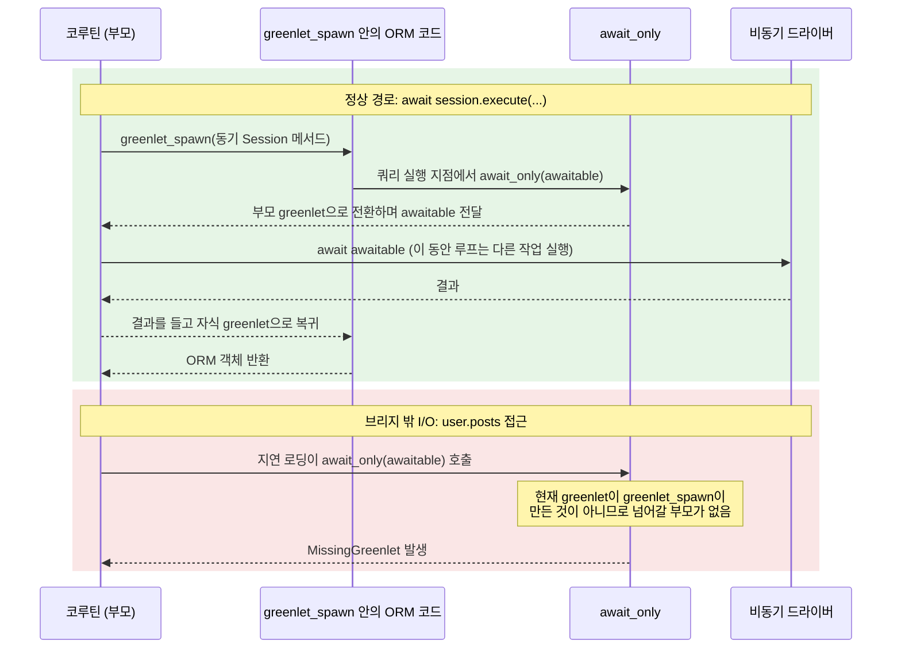

## 들어가며: 반복되는 greenlet 에러

FastAPI로 비동기 비즈니스 로직을 짜면서 SQLAlchemy의 `AsyncSession`을 쓰고 있었습니다. 그런데 조회 결과에서 속성 하나를 꺼내거나 응답을 반환하는 순간마다 아래 에러가 반복해서 터졌습니다.

```text
sqlalchemy.exc.MissingGreenlet: greenlet_spawn has not been called; can't call await_only() here. Was IO attempted in an unexpected place? (Background on this error at: https://sqlalche.me/e/20/xd2s)
```

처음에는 `await`를 빠뜨렸나 싶어서 코드를 다시 훑었지만, 에러가 난 줄에는 `await`를 붙일 자리조차 없었습니다. `user.posts`처럼 속성에 접근하는 평범한 코드였기 때문입니다.

한 곳을 고치면 다른 곳에서 같은 에러가 나니 꽤 짜증이 났습니다. 그래서 원인을 제대로 파 보기로 했고, 그 과정에서 Python 비동기와 GIL, 비동기 DB 드라이버의 내부 구조까지 따라 내려가게 됐습니다.

비동기 드라이버와 greenlet 브리지의 구조는 [Python 비동기는 GIL 때문에 가짜였나](https://bnbong.com/blog/20261014-python-async-db/)에서 자세히 다뤘습니다. 이 글은 그 글의 출발점이었던 에러 자체를 다루며, 왜 이 에러가 나는지와 상황별로 어떻게 고치는지를 정리합니다.

이 글은 FastAPI로 작은 서비스를 한 번쯤 만들어 본 분을 독자로 생각하고 썼습니다. 예제 코드는 SQLAlchemy 2.0.54, aiosqlite, FastAPI 0.143.1, Pydantic 2.14.1 환경에서 직접 실행해 확인했습니다.

결론부터 적으면 다음과 같습니다.

- MissingGreenlet은 ==`await`로 드러나지 않은 DB I/O==가 SQLAlchemy가 준비한 greenlet 영역 밖에서 일어날 때 발생합니다.
- 대부분은 지연 로딩, commit 뒤 만료된 속성, FastAPI의 응답 직렬화 세 가지 상황에서 나옵니다.
- 해결 원칙은 하나입니다. 필요한 데이터를 `await`가 붙은 호출 안에서 미리 다 읽어 두는 것입니다.

---

## greenlet 브리지 한 줄 요약

**이 절에서 확인할 질문**: `await session.execute()`는 동기 코드인 ORM을 어떻게 비동기 드라이버 위에서 실행하는가?

먼저 용어 하나를 정리하겠습니다. greenlet은 함수 실행을 중간에 멈추고 다른 greenlet으로 제어를 넘겼다가, 나중에 그 자리에서 이어서 실행할 수 있게 해 주는 라이브러리입니다.

SQLAlchemy ORM의 내부 코드는 원래 동기 코드입니다. 비동기 버전을 따로 만드는 대신, asyncio 확장은 이 동기 코드를 greenlet 안에서 실행하는 방식을 택했습니다.

`await session.execute()`를 호출하면 `AsyncSession`은 내부의 동기 `Session` 메서드를 `greenlet_spawn()`으로 감싸서 새 greenlet에서 실행합니다. 이때 `greenlet_spawn()`을 부른 코루틴 쪽이 부모 greenlet이 됩니다.

동기 코드가 쿼리를 보내려고 드라이버를 호출하는 지점에는 `await_only()`가 들어 있습니다. `await_only()`는 드라이버의 awaitable을 들고 부모 greenlet으로 전환하고, 부모 쪽 `greenlet_spawn()`이 그 awaitable을 실제로 `await`한 뒤 결과를 들고 다시 돌아옵니다.

공식 문서는 이 방식에 "thread executor"나 별도의 대기 장치가 없다고 설명합니다. 동기 코드와 비동기 코드가 같은 이벤트 루프 스레드 안에서 greenlet 전환으로 오갈 뿐입니다.

문제는 `greenlet_spawn()` 밖에서 동기 코드가 I/O를 시도할 때 생깁니다. `await_only()`는 현재 greenlet이 `greenlet_spawn()`이 만든 greenlet인지 먼저 확인하고, 아니라면 넘어갈 부모가 없으므로 MissingGreenlet을 던집니다. 들어가며에 적은 에러 메시지는 SQLAlchemy 소스의 이 분기에서 나옵니다.



/// caption
`await session.execute()`가 greenlet 브리지를 거치는 정상 경로와, 브리지 밖에서 I/O가 시작돼 MissingGreenlet이 나는 경로
///

**요약**: `await`가 붙은 `AsyncSession` 메서드는 ORM 코드를 `greenlet_spawn()` 안에서 실행하고, 드라이버 I/O 지점의 `await_only()`가 부모 greenlet으로 넘어가 실제 `await`를 수행합니다. 이 브리지 밖에서 I/O가 시작되면 넘어갈 부모가 없어서 MissingGreenlet이 발생합니다.

---

## 자주 터지는 상황 세 가지와 해결

**이 절에서 확인할 질문**: `await`를 빠뜨리지 않았는데도 MissingGreenlet이 나는 코드는 어떤 모양인가?

아래 예제는 모두 같은 모델을 씁니다. 사용자(`User`) 한 명이 게시글(`Post`) 여러 개를 갖는 일대다 관계입니다.

```python
from sqlalchemy import ForeignKey
from sqlalchemy.ext.asyncio import AsyncAttrs
from sqlalchemy.orm import DeclarativeBase, Mapped, mapped_column, relationship

class Base(AsyncAttrs, DeclarativeBase):
    pass

class User(Base):
    __tablename__ = "users"
    id: Mapped[int] = mapped_column(primary_key=True)
    name: Mapped[str]
    posts: Mapped[list["Post"]] = relationship(back_populates="author")

class Post(Base):
    __tablename__ = "posts"
    id: Mapped[int] = mapped_column(primary_key=True)
    title: Mapped[str]
    user_id: Mapped[int] = mapped_column(ForeignKey("users.id"))
    author: Mapped[User] = relationship(back_populates="posts")
```

`Base`에 섞은 `AsyncAttrs`는 첫 번째 상황의 해결 방법에서 쓰므로 미리 넣어 두었습니다.

### 1. 지연 로딩: 관계 속성에 그냥 접근할 때

지연 로딩(lazy loading)은 관계 속성을 처음 읽는 순간에 SELECT를 보내 데이터를 가져오는 방식이고, `relationship()`의 기본 동작입니다.

동기 `Session`에서는 아무 문제가 없던 코드가 `AsyncSession`에서는 바로 에러를 냅니다.

```python
async with SessionLocal() as session:
    user = await session.scalar(select(User).where(User.id == 1))
    print(user.posts)  # MissingGreenlet
```

`await session.scalar(...)`가 끝난 시점에는 이미 `greenlet_spawn()` 밖으로 나와 있습니다. 그 상태에서 `user.posts`를 읽으면 ORM이 SELECT를 보내려고 `await_only()`를 부르고, 넘어갈 부모가 없어 에러가 납니다.

공식 문서가 가장 먼저 권하는 방법은 즉시 로딩(eager loading)입니다. 즉시 로딩은 처음 조회할 때 관계 데이터까지 함께 읽어 오는 방식입니다.

```python
from sqlalchemy.orm import selectinload

stmt = select(User).where(User.id == 1).options(selectinload(User.posts))
user = await session.scalar(stmt)
print(user.posts)  # 이미 로드되어 있으므로 I/O가 없음
```

`selectinload()`는 관계 데이터를 `IN` 조건을 쓴 두 번째 SELECT로 읽고, 이 SELECT도 `await session.scalar()` 호출 안에서 실행됩니다. JOIN으로 한 번에 읽고 싶다면 `joinedload()`를 쓸 수 있습니다.

미리 로딩하기 어려운 경우에는 `AsyncAttrs`가 제공하는 `awaitable_attrs`로 속성 접근 자체를 `await` 가능한 호출로 바꿀 수 있습니다. 이 기능은 2.0.13에서 추가됐습니다.

```python
user = await session.scalar(select(User).where(User.id == 1))
posts = await user.awaitable_attrs.posts  # 브리지 안에서 지연 로딩
```

여러 속성을 동기 코드 방식으로 다뤄야 한다면 `AsyncSession.run_sync()`로 함수 하나를 통째로 greenlet 안에서 실행하는 방법도 있습니다.

```python
def collect_titles(sync_session, user):
    return [post.title for post in user.posts]

titles = await session.run_sync(collect_titles, user)
```

`run_sync()`에 넘긴 함수는 첫 번째 인자로 동기 `Session`을 받고, 그 안에서 일어나는 지연 로딩은 브리지를 거쳐 정상적으로 실행됩니다. 공식 문서는 `AsyncAttrs`가 바로 이 `run_sync()`와 같은 내부 방식을 간결하게 감싼 것이라고 설명합니다.

### 2. commit 뒤에 만료된 속성을 읽을 때

`Session`은 기본적으로 `expire_on_commit=True`로 동작합니다. commit이 끝나면 세션이 들고 있던 객체의 속성을 모두 만료시키고, 다음에 그 속성을 읽을 때 DB에서 다시 읽어 옵니다.

이 "다시 읽기"도 `await`가 없는 속성 접근에서 일어나므로 MissingGreenlet이 납니다.

```python
async with SessionLocal() as session:
    user = User(name="bnbong")
    session.add(user)
    await session.commit()
    print(user.name)  # MissingGreenlet: 만료된 속성을 다시 읽으려 함
```

공식 문서는 asyncio에서 `expire_on_commit`을 보통 `False`로 두라고 권합니다. 세션을 만드는 팩토리에서 한 번만 설정하면 됩니다.

```python
from sqlalchemy.ext.asyncio import async_sessionmaker

SessionLocal = async_sessionmaker(engine, expire_on_commit=False)

async with SessionLocal() as session:
    user = User(name="bnbong")
    session.add(user)
    await session.commit()
    print(user.name, user.id)  # 만료되지 않으므로 I/O가 없음
```

commit 뒤에 DB의 최신 값이 꼭 필요하다면, 문서의 안내대로 `expire()` 대신 `await session.refresh(user)`를 명시적으로 호출하면 됩니다.

### 3. FastAPI가 응답을 직렬화할 때

제가 가장 오래 헤맨 상황이 이것입니다. 엔드포인트 함수 안에서는 아무 에러가 없는데, 함수가 반환된 뒤에 에러가 납니다.

FastAPI 문서에 따르면 `response_model`이나 반환 타입을 선언하면 FastAPI가 반환된 데이터를 그 타입으로 변환하고 검증한 뒤 JSON으로 직렬화합니다. 즉 ORM 객체를 그대로 반환하면, 엔드포인트 함수가 끝난 뒤에 Pydantic이 그 객체의 속성을 하나씩 읽습니다.

```python
class UserOut(BaseModel):
    model_config = ConfigDict(from_attributes=True)
    id: int
    name: str
    posts: list[PostOut]

@app.get("/users/{user_id}", response_model=UserOut)
async def read_user(user_id: int, session: AsyncSession = Depends(get_session)):
    return await session.get(User, user_id)  # posts는 아직 로드되지 않음
```

이때 Pydantic이 `posts`를 읽으면서 지연 로딩이 시작되고, 그 지점은 당연히 `greenlet_spawn()` 밖입니다. 제 환경에서는 MissingGreenlet이 `ResponseValidationError`에 감싸져서 아래처럼 보고됐습니다.

```text
'type': 'get_attribute_error', 'loc': ('response', 'posts'),
'msg': "Error extracting attribute: MissingGreenlet: greenlet_spawn has not been called; ..."
```

에러 종류가 검증 에러로 보이기 때문에 처음에는 스키마 정의가 틀린 줄 알았습니다. 원인은 스키마가 아니라 직렬화 시점에 일어난 I/O였습니다.

해결 방법은 응답에 필요한 데이터를 엔드포인트 안에서 모두 읽고, ORM 객체 대신 Pydantic 모델로 바꿔서 반환하는 것입니다.

```python
@app.get("/users/{user_id}", response_model=UserOut)
async def read_user(user_id: int, session: AsyncSession = Depends(get_session)):
    stmt = select(User).where(User.id == user_id).options(selectinload(User.posts))
    user = await session.scalar(stmt)
    return UserOut.model_validate(user)  # 변환이 엔드포인트 안에서 끝남
```

`selectinload()`로 관계를 미리 읽어 두었기 때문에 `model_validate()`가 `posts`를 읽어도 I/O가 일어나지 않습니다. 변환을 엔드포인트 안에서 끝내 두면, 혹시 빠뜨린 관계가 있어도 에러가 엔드포인트 코드의 줄 번호와 함께 나서 원인을 찾기도 쉬워집니다.

### 별개 문제: greenlet이 설치되지 않은 경우

이름이 비슷해서 헷갈리지만, 아래 에러는 MissingGreenlet과 원인이 다릅니다.

```text
ValueError: the greenlet library is required to use this function. No module named 'greenlet'
```

이 에러는 greenlet 패키지 자체가 설치되지 않았을 때 납니다. 공식 문서에 따르면 greenlet은 x86_64, aarch64 같은 주요 플랫폼에서는 기본으로 함께 설치되지만, 미리 빌드된 wheel이 없는 플랫폼에서는 설치되지 않습니다.

플랫폼과 관계없이 greenlet을 함께 설치하려면 `asyncio` extra를 지정하면 됩니다.

```bash
pip install "sqlalchemy[asyncio]"
```

zsh에서는 대괄호가 패턴으로 해석되므로 따옴표로 감싸야 합니다.

**요약**: MissingGreenlet은 지연 로딩, commit 뒤 만료 속성 접근, FastAPI 응답 직렬화처럼 `await` 없이 I/O가 시작되는 지점에서 납니다. 해결 방법은 즉시 로딩, `awaitable_attrs`, `run_sync()`, `expire_on_commit=False`, 엔드포인트 안에서의 Pydantic 변환이며, greenlet 미설치 에러는 설치 문제로 따로 다뤄야 합니다.

---

## 왜 이게 구조적인 문제인가

**이 절에서 확인할 질문**: MissingGreenlet은 사용자의 실수인가, 아니면 SQLAlchemy asyncio 확장의 구조에서 나오는 결과인가?

asyncio의 기본 원칙은 I/O가 일어날 수 있는 모든 지점에 `await`를 붙이는 것입니다. 그래야 코드를 읽는 사람도, 이벤트 루프도 어디서 실행이 멈출 수 있는지 알 수 있습니다.

반면 동기 ORM은 I/O를 언제 할지 ORM이 스스로 결정합니다. 지연 로딩, 만료된 속성 다시 읽기, autoflush는 모두 사용자가 속성에 접근하거나 쿼리를 실행하는 순간 ORM이 알아서 SQL을 보내는 기능입니다.

그래서 SQLAlchemy ORM을 asyncio 위에 올리면, ==`await`로 드러나지 않는 I/O 지점==이 자연스럽게 생깁니다. 속성 접근 문법은 `await`를 붙일 수 없으니 이 지점을 코드 겉모습만으로는 알아볼 수 없습니다.

greenlet 브리지는 이 숨은 I/O를 이벤트 루프로 돌려보내는 장치입니다. 다만 브리지가 동작하려면 바깥에 `await`된 `greenlet_spawn()`이 있어야 하고, 그 범위를 벗어나면 돌려보낼 곳이 없습니다.

공식 문서도 `run_sync()`를 설명하면서 이 방식이 "I/O가 일어날 수 있는 모든 문장에 `await`를 붙인다"는 asyncio의 철학과 어긋날 수 있다고 직접 적어 두었습니다. MissingGreenlet은 이 어긋남이 런타임에 드러나는 지점이라고 보면 됩니다.

직전 글에서 SQLAlchemy asyncio 확장의 비용은 I/O 대기가 아니라 greenlet 전환과 ORM의 파이썬 연산이라고 정리했습니다. 이번 글의 내용과 합치면, 이 확장은 동기 ORM의 편의와 비용을 그대로 가져오는 대신 I/O 시점을 `await` 안으로 모아 두라는 규칙을 사용자에게 요구한다고 볼 수 있습니다.

**요약**: 동기 ORM은 I/O 시점을 스스로 결정하므로 `await`로 드러나지 않는 I/O가 생기고, greenlet 브리지는 `greenlet_spawn()` 범위 안에서만 그 I/O를 이벤트 루프로 돌려보냅니다. MissingGreenlet은 이 범위를 벗어난 I/O가 실행 시점에 드러난 결과입니다.

---

## 마무리: 상황별 체크리스트

MissingGreenlet을 만났을 때 확인할 항목을 표로 정리했습니다.

| 상황 | 증상 | 해결 |
| --- | --- | --- |
| 관계 속성 지연 로딩 | `user.posts` 같은 속성 접근 줄에서 MissingGreenlet | `selectinload()`·`joinedload()`로 즉시 로딩, `await obj.awaitable_attrs.posts`, `await session.run_sync(fn)` |
| commit 뒤 속성 접근 | `await session.commit()` 직후 일반 컬럼 접근에서 MissingGreenlet | `async_sessionmaker(engine, expire_on_commit=False)`, 최신 값이 필요하면 `await session.refresh(obj)` |
| FastAPI가 ORM 객체 직렬화 | 엔드포인트 반환 뒤 `ResponseValidationError` 안에 MissingGreenlet | 엔드포인트 안에서 즉시 로딩 후 `Model.model_validate(obj)`로 변환해 반환 |
| greenlet 미설치 | `ValueError: the greenlet library is required ...` | `pip install "sqlalchemy[asyncio]"` |

정리하면 MissingGreenlet은 `await`를 하나 빠뜨린 실수라기보다, I/O가 어디서 일어나는지 ORM에게 맡겨 둔 대가입니다. 저는 이제 `AsyncSession`을 쓸 때 "이 데이터는 어느 `await` 안에서 읽히는가"를 먼저 따져 보고, 응답에 필요한 관계는 조회할 때 즉시 로딩으로 함께 읽어 두는 방식으로 코드를 짭니다.

---

## 참고 자료

**SQLAlchemy**

- SQLAlchemy Asynchronous I/O (asyncio), Preventing Implicit IO when Using AsyncSession: <https://docs.sqlalchemy.org/en/20/orm/extensions/asyncio.html#preventing-implicit-io-when-using-asyncsession>
- SQLAlchemy Asynchronous I/O (asyncio), Running Synchronous Methods and Functions under asyncio: <https://docs.sqlalchemy.org/en/20/orm/extensions/asyncio.html#running-synchronous-methods-and-functions-under-asyncio>
- SQLAlchemy Asynchronous I/O (asyncio), Asyncio Platform Installation Notes: <https://docs.sqlalchemy.org/en/20/orm/extensions/asyncio.html#asyncio-platform-installation-notes-including-apple-m1>
- SQLAlchemy Error Messages, MissingGreenlet: <https://docs.sqlalchemy.org/en/20/errors.html#error-xd2s>
- SQLAlchemy `_concurrency_py3k.py` (`await_only`, `greenlet_spawn`): <https://github.com/sqlalchemy/sqlalchemy/blob/rel_2_0/lib/sqlalchemy/util/_concurrency_py3k.py>
- SQLAlchemy `concurrency.py` (greenlet 미설치 시 에러): <https://github.com/sqlalchemy/sqlalchemy/blob/rel_2_0/lib/sqlalchemy/util/concurrency.py>

**FastAPI**

- FastAPI, Response Model - Return Type: <https://fastapi.tiangolo.com/tutorial/response-model/>

**관련 글**

- bnbong, Python 비동기 DB 드라이버에 관하여: <https://bnbong.com/blog/20261014-python-async-db/>
