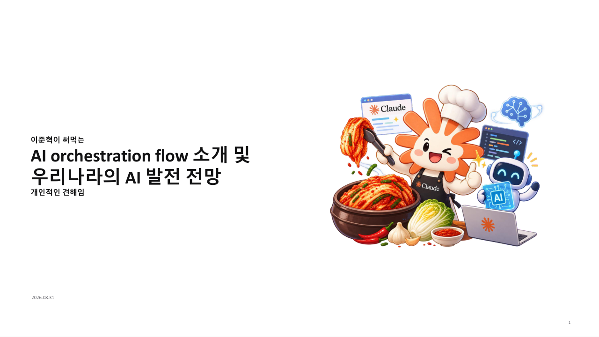
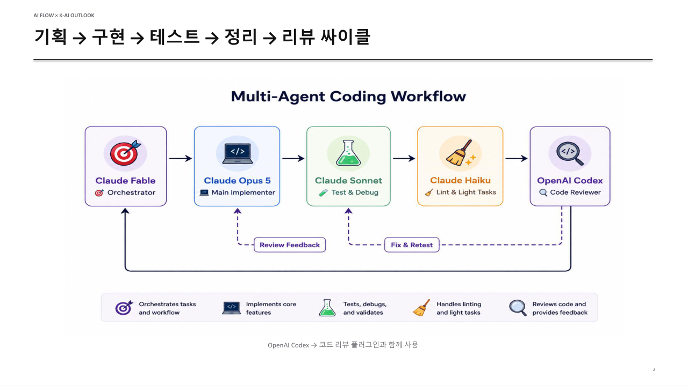
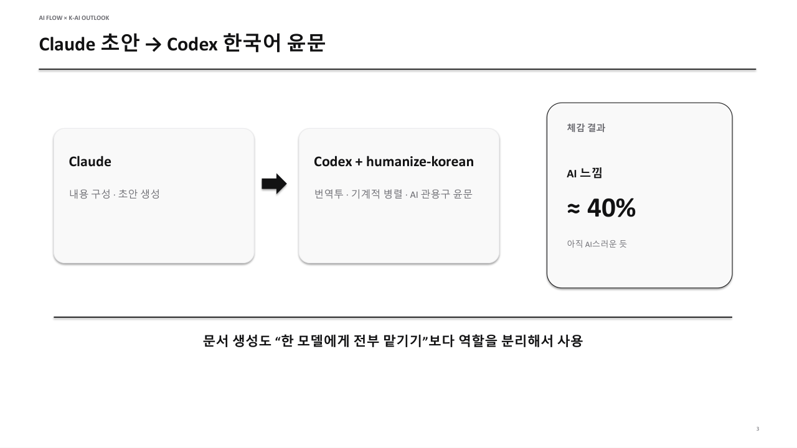
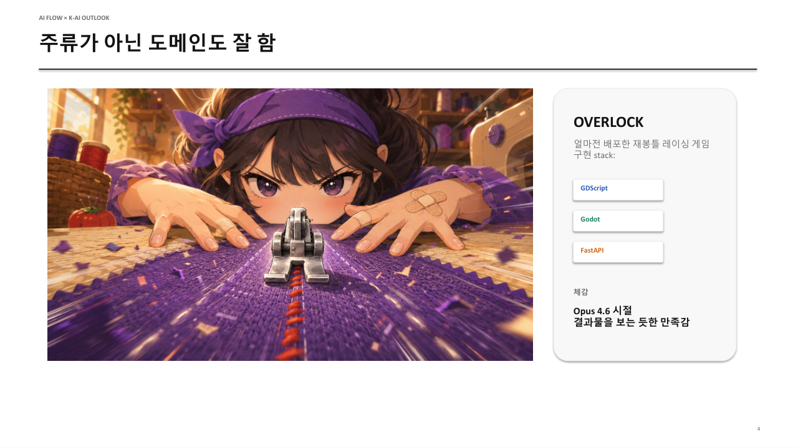
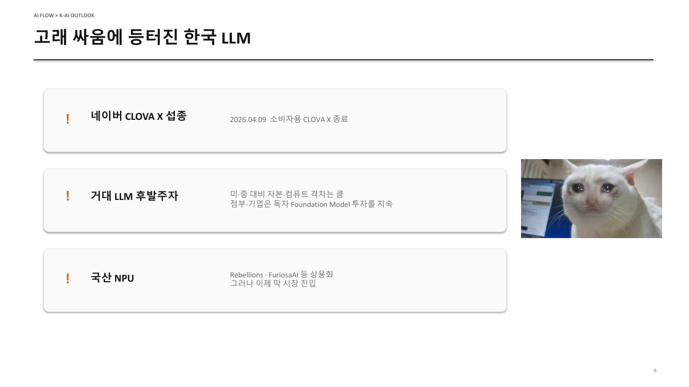
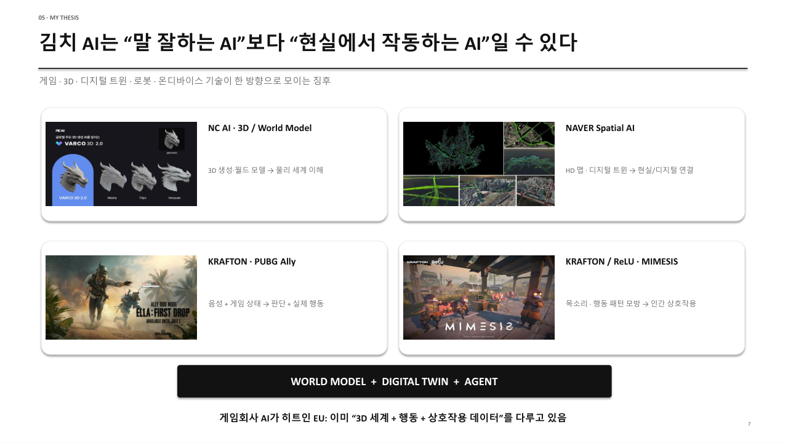

/// caption
발표자료에 썼던 표지입니다. 김치 AI(대한민국의 자랑스러운 AI)라는 뜻
///

지난 8월 31일에 SSAFY 16기 동기들 앞에서 "이준혁이 써먹는 AI orchestration flow 소개 및 우리나라의 AI 발전 전망"이라는 제목으로 발표를 했습니다. 발표한 지 두 달 정도 지났는데, 슬라이드로만 남겨 두기에는 아쉬워서 글로 정리해 둡니다.

이 글에 적은 내용은 모두 제 개인적인 생각일 뿐이며, 정답이나 업계의 공식적인 전망이 아닙니다.

## 현재 쓰고 있는 AI 오케스트레이션 흐름

/// caption
기획, 구현, 테스트, 정리, 리뷰를 여러 모델에게 나눠 맡기는 멀티 에이전트 코딩 워크플로우
///

제가 개발할 때 쓰는 구성입니다. 모델 다섯 개에게 역할을 하나씩 맡기는 구성입니다.

- Claude Fable: 오케스트레이터로서 작업을 분해하고 배분합니다.
- Claude Opus 5: 핵심 기능을 구현합니다.
- Claude Sonnet: 테스트와 디버깅, 검증을 맡습니다.
- Claude Haiku: 린트와 가벼운 작업을 맡습니다.
- OpenAI Codex: 코드 리뷰와 피드백을 맡습니다. Codex는 코드 리뷰 플러그인과 함께 사용합니다.

피드백 루프는 두 갈래로 나뉩니다. Codex가 리뷰한 결과는 "Review Feedback"으로 Opus에게 돌아가고, "Fix & Retest"로 Sonnet에게도 넘어갑니다. 이렇게 나온 전체 결과는 다시 Fable에게 모입니다.

역할을 나누는 이유는 단순합니다. 한 모델에게 기획부터 리뷰까지 전부 맡기면, 결국 자기가 작성한 코드를 자기가 검토하게 됩니다. 저는 구현한 모델과 다른 계열의 모델이 리뷰를 맡아야 놓친 부분이 드러난다고 봅니다. 또 린트처럼 판단할 거리가 적은 작업까지 가장 무거운 모델에게 맡길 필요는 없습니다. 작업의 무게에 맞춰 모델을 고르는 편이 효율적이라고 판단했습니다.

이 구성은 [Overlock 프로젝트 소개](https://bnbong.com/projects/overlock/)에 적은 개발 구성과 같습니다.

## 문서도 역할을 나눠서

/// caption
Claude가 초안을 쓰고 Codex가 한국어 윤문을 맡는 문서 작성 흐름
///

코드만 이렇게 나누어 맡기는 것은 아닙니다. 문서를 만들 때도 내용 구성과 초안 생성은 Claude에게 맡기고, 번역투와 기계적인 병렬 구조, AI가 자주 쓰는 관용구를 다듬는 윤문은 Codex와 humanize-korean에게 맡깁니다.

솔직하게 말하면 결과가 아직 만족스럽지는 않습니다. 제 체감으로는 AI 느낌이 40% 정도 남아 있고, 다시 읽어 보면 여전히 AI가 쓴 글처럼 보입니다. 그래도 문서 생성 역시 한 모델에게 전부 맡기는 것보다 역할을 분리해서 쓰는 편이 낫다는 것이 발표에서 내린 결론이었습니다.

그래서 발표 이후 현재 시점에는 humanize-korean이 아닌 fluent-korean 이라는 플러그인을 물려 사용하고 있습니다. 개인적으로는 humanize-korean보다 한글 문장을 잘 만드는 느낌입니다.

## 주류가 아닌 도메인에서도

/// caption
이 흐름으로 만든 재봉틀 레이싱 게임 Overlock
///

최근 한번도 다뤄본 적 없던 게임 개발을 이 플로우를 활용해서 완료했고 그 덕에 Overlock이 탄생했습니다. Overlock은 Godot 엔진과 GDScript로 만들었고, 서버는 FastAPI로 구현했습니다. 게임 엔진과 GDScript는 LLM으로 개발하는 분야 중에서 주류라고 보기 어렵지만, 위에서 소개한 구성으로 개발부터 배포까지 마쳤습니다.

슬라이드에는 체감을 "Opus 4.6 시절 결과물을 보는 듯한 만족감"이라고 적었습니다. 개발 과정은 [Overlock 개발 기록](https://bnbong.com/blog/20260829-overlock/)에 정리해 두었고, 게임은 [itch.io](https://bnbong.itch.io/overlock)에서 플레이할 수 있습니다.

## 비용

이 구성을 유지하는 데 드는 구독료입니다(ㅠㅠ). Claude Max 5x가 월 100달러, ChatGPT Plus가 월 20달러여서 한 달에 약 120달러를 냅니다.

## 고래 싸움에 등 터진 한국 LLM

/// caption
한국 LLM의 현재
///

이제 한국 AI 이야기입니다. 아래 세 항목은 발표를 준비하던 시점에 제가 정리한 내용입니다.

- 네이버 CLOVA X: 소비자용 CLOVA X 서비스가 2026년 4월 9일에 종료되었습니다.
- 거대 LLM 후발주자: 미국, 중국과 비교하면 자본과 컴퓨트 격차가 큽니다. 그래도 정부와 기업은 독자 Foundation Model에 계속 투자하고 있습니다.
- 국산 NPU: Rebellions, FuriosaAI 같은 회사가 상용화에 나섰지만, 이제 막 시장에 진입한 단계입니다.

## 말 잘하는 AI보다 현실에서 작동하는 AI

/// caption
가설과 네 가지 사례
///

제가 내세운 가설은 한국 AI가 "말 잘하는 AI"보다 "현실에서 작동하는 AI"일 수 있다는 것입니다. 게임, 3D, 디지털 트윈, 로봇, 온디바이스 기술이 한 방향으로 모이는 징후가 보인다고 생각했고, 근거로 네 가지 사례를 들었습니다.

- NC AI의 VARCO 3D 2.0: 3D 생성과 월드 모델로 물리 세계를 이해하는 방향입니다.
- NAVER Spatial AI: HD 맵과 디지털 트윈으로 현실과 디지털을 연결합니다.
- KRAFTON의 PUBG Ally(ELLA: First Drop): 음성과 게임 상태를 받아 판단하고 실제 행동까지 합니다.
- KRAFTON과 ReLU의 MIMESIS: 목소리와 행동 패턴을 모방해 사람과 상호작용합니다.

저는 이 사례들을 "WORLD MODEL + DIGITAL TWIN + AGENT"라는 문구로 묶었습니다. 그중에서도 게임회사의 AI를 눈여겨본 이유는, 게임회사가 이미 3D 세계와 행동, 상호작용 데이터를 다루고 있기 때문입니다. 거대 언어 모델 경쟁과는 다른 방향에서 한국 AI가 나아갈 길을 찾을 수 있다고 본 것입니다.

## 그럼 우리는 멀 해야함?

몰루겟슴미다,,, 로드맵을 잡기엔 세상이 너무 빨리 바뀌어요

일단 주식부터 줍는게 나을수도
