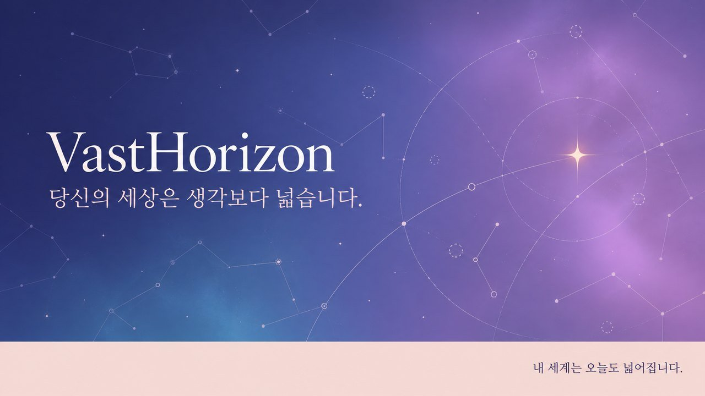
/// caption
README에 넣은 VastHorizon 키 비주얼입니다. "당신의 세상은 생각보다 넓습니다."
///

VastHorizon은 3D 하늘에서 천체를 고르고 질문하면, 모아 둔 문서에 근거해서만 답하는 우주 지식 서비스입니다. SSAFY 과제로 시작했고, 지금은 누구나 쓸 수 있는 공개 서비스로 운영하고 있습니다.

이 글에서는 제가 이 서비스를 왜 만들었는지 먼저 적고, 지금 배포된 사이트의 화면을 하나씩 보여 드리며 핵심 기능을 소개하겠습니다. RAG 구조와 설계 결정은 [VastHorizon 프로젝트 소개](https://bnbong.com/projects/vasthorizon/)에 따로 정리해 두었습니다.

<https://vasthorizon.bnbong.com>

## 왜 우주였고, 왜 위로였나

저는 개인적으로 우주에 관심이 많고, 밤에 별을 보는 것을 좋아합니다. 과제에서 RAG로 다룰 도메인을 무엇으로 정할지 고민하던 중에 우주가 번뜩 떠올랐고, 그래서 우주를 도메인으로 정했습니다.

도메인을 정한 뒤에는 우주와 관련해서 어떤 서비스를 만들지 고민했습니다. 그러던 중에 Gemini와 블랙홀에 대해 이야기를 나누다가 양자역학을 조금 배우게 되었습니다.

그 이론을 제 나름대로 이해하면서 어떤 천체는 누군가 인지하기 전까지 마치 슈뢰딩거의 고양이처럼 양자역학적인 상태에 있다는 느낌을 받았습니다. 그 느낌은 "알아 가는 만큼 세상이 넓어진다"는 감성으로 이어졌습니다.

요즘 사회에는 우울감을 느끼는 청년과 직장인이 많습니다. 저는 이 감성을 그분들에게 위로가 되는 방향으로 풀어 보고 싶었습니다. "당신의 세상은 작지 않고, 이렇게나 넓어질 수 있다"는 위안을 주는 프로젝트를 만들고 싶었던 것입니다.

다만 서비스에서는 슈뢰딩거의 고양이 비유를 배움에 대한 은유로만 썼고, 관측이 천체의 상태를 정한다는 과학적 주장으로는 쓰지 않았습니다. 디자인 시안의 중심 문장도 '관측자가 정답을 결정한다'가 아니라 '내가 알아간 만큼 내 세계가 넓어진다'로 정했습니다.

이런 서비스는 감성적인 말로만 채우기 쉽습니다. 그래서 첫날 쓴 기획안에 핵심 원칙을 먼저 적어 두었습니다.

!!! quote "기획안의 핵심 원칙"
    위로를 지어내지 않습니다. 사실로 위로합니다.

기획안에는 이 원칙 아래에 "감성 서비스이기에 오히려 근거가 필수입니다. 지어낸 위로는 틀린 사실을 퍼뜨리기 쉽기 때문입니다."라는 문장도 덧붙였습니다. 아래에서 소개할 기능은 모두 이 문장을 기준으로 만들었습니다.

## 과제에서 서비스로

출발점은 SSAFY 16기 AI 코어 과정의 "RAG 기반 도메인 지식 서비스" 과제였습니다. 과제 기간은 10월 21일부터 23일까지 3일이었습니다. 저는 과제 조건에 맞춰 다음 세 가지를 준비했습니다.

- 천체 항목 메타데이터 424건 수집
- 외부 문서의 출처와 이용 조건 명시
- 근거 없이 답하면 틀리기 쉬운 질문 준비

과제 기간에는 SSAFY가 제공한 OpenAI 호환 API로 답변을 생성했고, 검증은 Streamlit으로 만든 검증 페이지에서 진행했습니다.

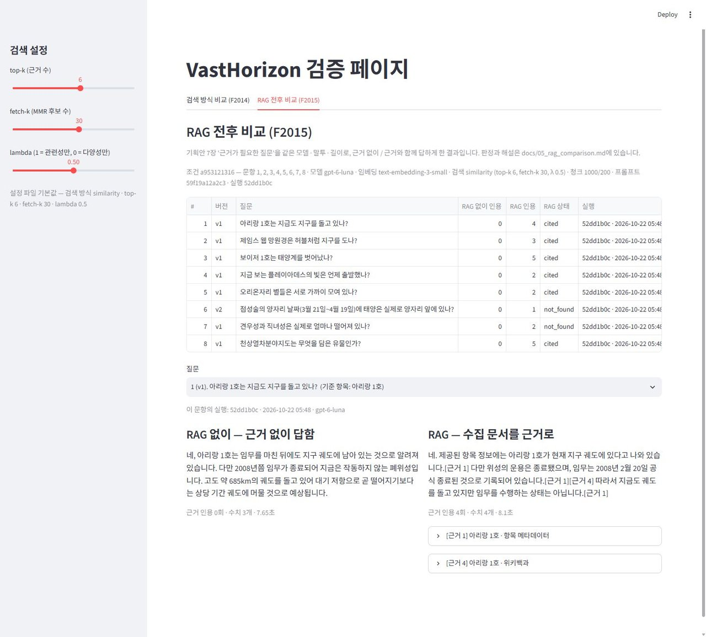
/// caption
Streamlit 검증 페이지의 'RAG 전후 비교(F2015)' 탭입니다. 아리랑 1호 질문에 대해 RAG 없이 받은 답(근거 인용 0회)과 RAG로 받은 답(근거 인용 4회)을 나란히 놓았습니다
///

검증 가운데 가장 의미 있었던 항목은 RAG 전후 비교였습니다. 근거가 필요한 질문 8개를 준비하고, 다른 조건은 같게 둔 채 근거 문서를 뺐을 때와 넣었을 때의 답을 비교했습니다.

| 조건 | 질문 8개에 대한 결과 |
|---|---|
| RAG 없이 | 8개 모두 그럴듯했지만 근거가 없었음 |
| RAG | 6개는 맞았고, 나머지 2개는 근거가 부족해 확인할 수 없다고 솔직하게 답함 |

근거가 없을 때 "확인되지 않는다"고 답하는 쪽이 그럴듯하게 단정하는 쪽보다 낫다는 원칙을 이 결과로 확인했습니다.

과제 마지막 날인 10월 23일에는 답변 생성을 Claude API로 옮기고, 임베딩을 서버 안에서 계산하도록 바꿨습니다. 그리고 GitHub Actions 릴리스 파이프라인으로 첫 배포를 마쳤습니다. 그 뒤로도 기능을 계속 추가하며 개발을 이어 가고 있습니다.

## 화면과 기능

이 절에 실은 화면은 모두 10월 27일에 배포된 사이트를 직접 캡처한 것입니다. 캡처 아래쪽에 보이는 "알아간 빛 22개"와 "5,781.1만 광년"은 제 브라우저에 쌓인 기록입니다. 처음 들어온 사람은 지평선에서 출발합니다.

이 절에서 소개할 화면은 다음 아홉 가지입니다.

1. 프롤로그
2. 첫 하늘
3. 천체 서랍과 근거 있는 답변
4. 은하 중심 블랙홀 카드
5. 내 세계 지도와 우주 끝까지 떠나 보기
6. 빛의 편지
7. 마음 한 줄
8. 조건 탐색
9. 오늘 밤 내 빛, 두 눈으로 본 빛, 하늘 가리키기

마지막에는 공유와 음성 읽기, 휴대폰 화면을 짧게 덧붙이겠습니다.

### 프롤로그: 지평선에서 250만 년 전의 빛까지

서비스에 처음 들어오면 짧은 프롤로그가 나옵니다. 프롤로그는 지구 위에 선 '나'에서 출발해, 고개를 들면 얼마나 먼 곳의 빛까지 닿는지를 몇 장면에 걸쳐 보여 줍니다.

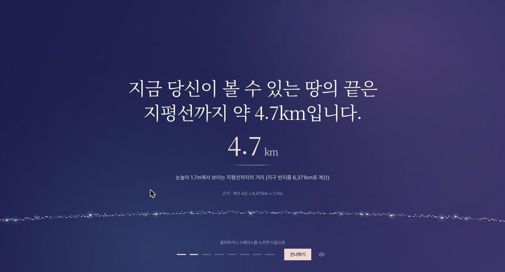
/// caption
프롤로그 두 번째 장면입니다. 눈높이 1.7m에서 보이는 지평선까지의 거리 4.7km와 그 계산식을 근거로 함께 보여 줍니다
///

먼저 지금 내 눈으로 볼 수 있는 땅의 끝인 지평선까지의 거리가 약 4.7km라는 사실을 보여 줍니다. 이 숫자에도 근거를 붙였습니다. 눈높이 1.7m와 지구 반지름 6,371km로 계산한 값이라는 점을 화면 아래에 계산식으로 적었습니다.

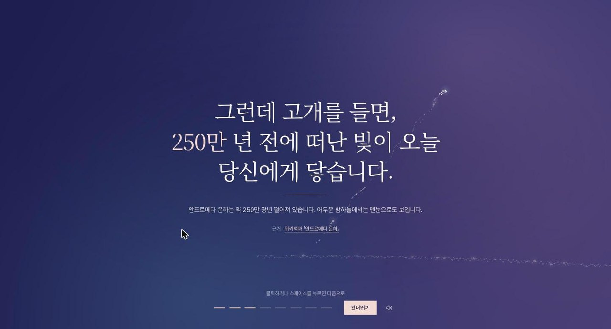
/// caption
프롤로그 세 번째 장면입니다. "그런데 고개를 들면, 250만 년 전에 떠난 빛이 오늘 당신에게 닿습니다." 근거로 위키백과 「안드로메다 은하」를 연결했습니다
///

다음 장면에서는 고개를 들면 250만 년 전에 떠난 안드로메다 은하의 빛이 오늘 나에게 닿는다고 알려 줍니다.

| 바라보는 곳 | 닿는 거리 |
|---|---|
| 땅(지평선) | 약 4.7km |
| 하늘(안드로메다 은하) | 250만 광년 |

땅에서는 4.7km밖에 보지 못하지만, 하늘을 보면 250만 광년까지 닿습니다. 이 대비는 이 서비스가 전하고 싶은 감각을 가장 짧게 보여 줍니다.

### 첫 하늘: 오늘 밤 여기서 보이는 빛

프롤로그가 끝나면 '첫 하늘'이 열립니다. 첫 하늘에는 오늘 밤 지금 있는 자리에서 보이는 별자리와 천체가 실제 하늘의 배치대로 떠 있습니다.

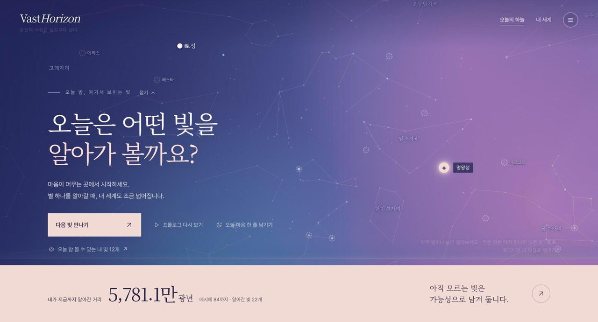
/// caption
첫 하늘 화면입니다. "오늘은 어떤 빛을 알아가 볼까요?"라는 안내 아래로 토성과 명왕성, 염소자리 같은 천체가 떠 있고, 맨 아래에 "내가 지금까지 알아간 거리"가 보입니다
///

가운데에는 "오늘은 어떤 빛을 알아가 볼까요?"라는 문장을 두었습니다. 사용자는 하늘에 떠 있는 아무 천체나 눌러 알아 갈 수 있고, '다음 빛 만나기' 버튼을 눌러 시작할 수도 있습니다.

하늘 아래쪽에는 지평선부터 태양계, 별, 은하를 거쳐 우주의 끝까지 이어지는 막대가 있습니다. 거리 차이가 너무 크기 때문에 이 막대는 로그 스케일로 그렸습니다.

막대 아래에는 내가 지금까지 알아간 가장 먼 빛까지의 거리가 나옵니다. 천체를 하나 알아 갈 때마다 이 거리가 늘어나므로 '내 세계가 넓어진다'는 감각을 숫자로 확인할 수 있습니다.

### 천체 서랍과 근거 있는 답변

하늘에서 천체를 누르면 오른쪽에 그 천체의 서랍이 열립니다. 서랍의 첫 문장은 그 천체의 빛이 언제 떠났는지 알려 줍니다.

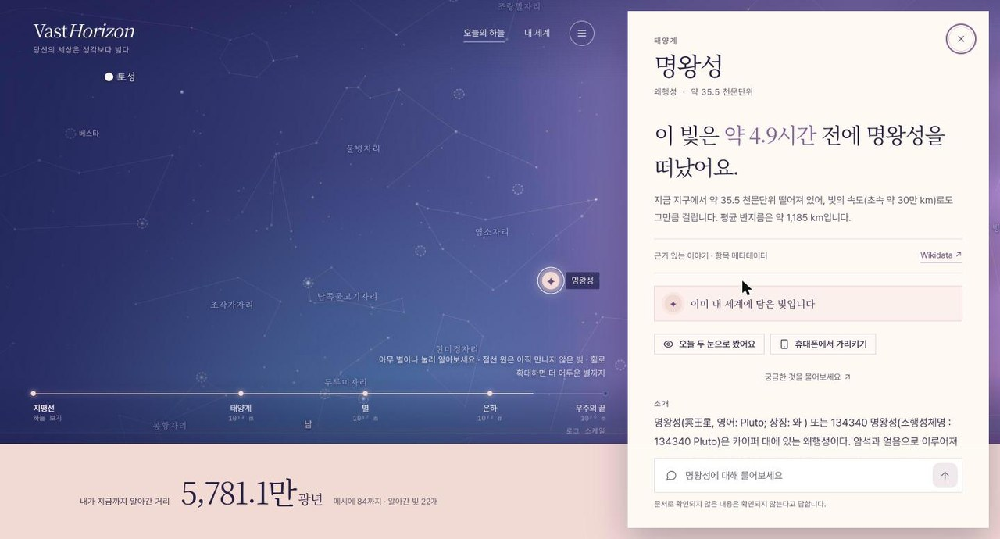
/// caption
명왕성 서랍의 윗부분입니다. "이 빛은 약 4.9시간 전에 명왕성을 떠났어요"라는 문장 아래에 근거(Wikidata 항목 메타데이터)와 '오늘 두 눈으로 봤어요', '휴대폰에서 가리키기' 버튼이 있습니다
///

명왕성을 누르면 "이 빛은 약 4.9시간 전에 명왕성을 떠났어요"라는 문장이 나타납니다. 이어서 명왕성이 지금 지구에서 약 35.5 천문단위 떨어져 있어서 빛의 속도로도 그만큼 걸린다는 설명이 나옵니다. 이 값의 근거가 Wikidata 항목 메타데이터라는 점도 함께 보여 줍니다.

이미 알아 간 천체에는 "이미 내 세계에 담은 빛입니다"라는 표시가 붙습니다.

서랍 아래쪽 입력창에서는 그 천체에 대해 자유롭게 질문할 수 있습니다. 질문을 받으면 서비스는 그 천체에 대해 모아 둔 문서에서 근거를 찾아 답합니다.

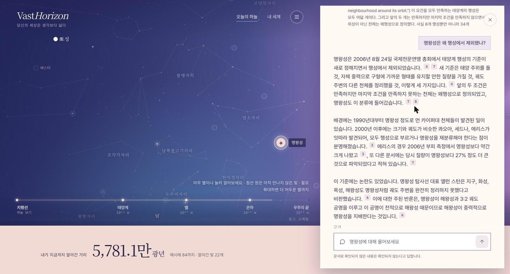
/// caption
"명왕성은 왜 행성에서 제외됐나?"라는 질문에 받은 답입니다. 2006년 8월 24일 국제천문연맹 총회와 행성의 세 조건, 에리스 발견, 앨런 스턴의 비판까지 문장마다 근거 번호가 붙어 있습니다
///

"명왕성은 왜 행성에서 제외됐나?"라고 물으면 2006년 8월 24일 국제천문연맹 총회에서 행성의 기준이 새로 정해졌다는 사실부터 답합니다. 답은 행성의 세 가지 조건과 에리스의 발견을 거쳐, 그 기준에 대한 앨런 스턴의 비판과 반론까지 이어집니다.

문장마다 어느 문서에서 가져온 내용인지 알려 주는 근거 번호가 붙습니다. 답 아래에는 근거 번호에 해당하는 문서 목록이 정리되어 있습니다.

입력창 아래에는 "문서로 확인되지 않은 내용은 확인되지 않는다고 답합니다"라는 문장을 항상 띄워 둡니다. 이 문장은 RAG 전후 비교에서 얻은 원칙을 사용자에게도 미리 약속합니다.

### 은하 중심 블랙홀을 계산으로 그렸습니다

제가 이 서비스에서 특히 마음에 들어 하는 화면이 있습니다. 안드로메다 은하처럼 중심 블랙홀에 대한 근거가 있는 은하의 서랍을 열면, 아래쪽에 그 블랙홀을 3D로 그린 카드가 나옵니다.

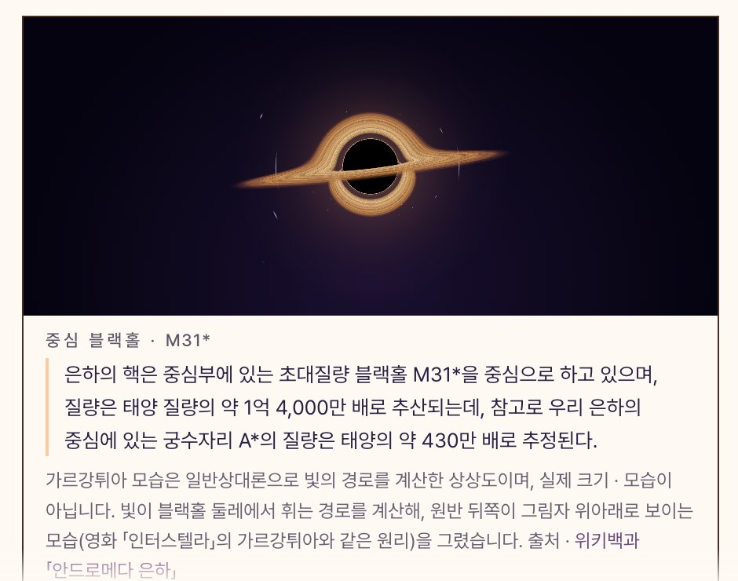
/// caption
안드로메다 은하 서랍의 '중심 블랙홀 · M31*' 카드입니다. 검은 그림자 둘레로 강착 원반이 보이고, 원반 뒤쪽이 그림자의 위아래로 휘어 올라와 보입니다. 아래에는 위키백과 인용문과 상상도라는 안내문이 있습니다
///

**원리.** 이 블랙홀은 그림 파일이 아닙니다. 화면의 각 점에서 빛을 거꾸로 쏘아 보낸 뒤, 그 빛이 슈바르츠실트 블랙홀 둘레에서 휘어지는 경로를 따라가며 계산해 그립니다. 계산은 슈바르츠실트 반지름을 1로 놓은 단위로 하고, three.js 위에서 GLSL 프래그먼트 셰이더로 실행합니다.

빛이 반지름 1 안으로 들어가면 다시 돌아오지 못하므로 그 점은 검은 그림자가 됩니다. 블랙홀의 적도면에는 안쪽 반지름이 3 근처인 얇은 강착 원반을 두고, 빛이 원반을 지날 때마다 밝기를 더합니다.

빛이 블랙홀 둘레에서 크게 휘기 때문에 원래는 블랙홀 뒤에 가려져야 할 원반 뒤쪽이 그림자의 위아래로 휘어 보입니다. 원반을 여러 번 돌고 나오는 빛은 그림자 가장자리에 얇은 광자 고리를 만듭니다. 이 모습은 영화 「인터스텔라」에 나온 가르강튀아와 같은 원리로 만들어집니다.

**원반.** 원반의 모습에도 계산을 반영했습니다. 원반의 온도는 안쪽으로 갈수록 높아지게 했고, 원반의 고리 무늬는 케플러 회전을 따라 안쪽이 더 빨리 돌게 했습니다. 다만 원반이 다가오는 쪽과 멀어지는 쪽의 도플러 밝기 차이는 넣지 않았습니다.

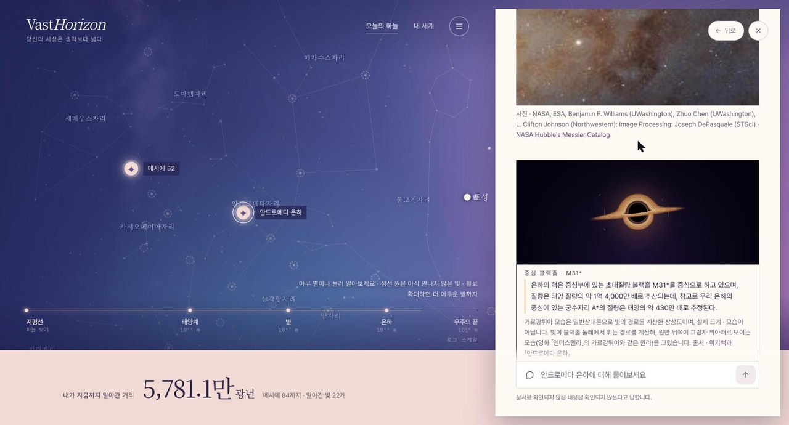
/// caption
데스크톱에서 본 안드로메다 은하 서랍입니다. 허블 사진과 출처 표기 아래에 중심 블랙홀 카드가 이어지고, 맨 아래에 "안드로메다 은하에 대해 물어보세요" 입력창이 있습니다
///

이 카드도 근거가 있는 은하에서만 보여 줍니다. 위키 문서의 문장이나 Wikidata에 중심 블랙홀에 대한 내용이 있어야 카드가 나타납니다. 안드로메다 은하 카드에는 위키백과 「안드로메다 은하」에서 가져온 "은하의 핵은 중심부에 있는 초대질량 블랙홀 M31*을 중심으로 하고 있으며, 질량은 태양 질량의 약 1억 4,000만 배로 추산되는데, 참고로 우리 은하의 중심에 있는 궁수자리 A*의 질량은 태양의 약 430만 배로 추정된다."라는 문장을 함께 실었습니다.

그리고 카드마다 다음 안내문을 달았습니다.

!!! note "상상도 안내문"
    가르강튀아 모습은 일반상대론으로 빛의 경로를 계산한 상상도이며, 실제 크기 · 모습이 아닙니다.

이 안내문을 단 이유는 계산으로 그린 모습이 실제 관측 사진처럼 받아들여지면 그것도 지어낸 사실이 되기 때문입니다.

데스크톱에서는 블랙홀을 서랍 안의 카드로 보여 줍니다. 빛의 경로 계산이 무거운 휴대폰에서는 화소 수를 30만으로 제한하고 무대 위 오버레이로 띄웁니다.

### 내 세계 지도와 우주 끝까지 떠나 보기

상단 메뉴에서 '내 세계'로 이동하면 지금까지 알아간 천체가 나를 중심으로 한 지도에 모여 있습니다.

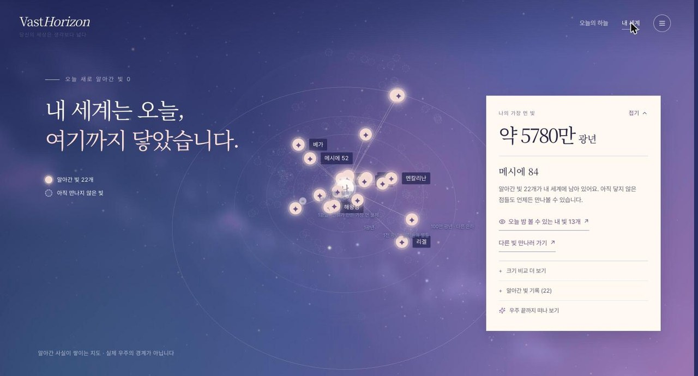
/// caption
내 세계 지도입니다. "내 세계는 오늘, 여기까지 닿았습니다"라는 문장 옆으로 알아간 빛 22개와 아직 만나지 않은 빛이 구분되어 있고, 오른쪽 패널에 나의 가장 먼 빛인 메시에 84(약 5780만 광년)가 보입니다
///

지도에서 또렷한 점은 이미 알아간 빛이고, 점선 원은 아직 만나지 않은 빛입니다. 제 브라우저에는 지금 빛 22개가 담겨 있고, 그 가운데 가장 먼 빛은 약 5780만 광년 떨어진 메시에 84입니다.

오른쪽 패널에는 "아직 닿지 않은 점들도 언제든 만나볼 수 있습니다"라는 문장을 두었습니다. 아직 모르는 빛이 부족함이 아니라 가능성으로 보이게 하려는 의도였습니다.

패널 맨 아래의 '우주 끝까지 떠나 보기'를 누르면 내 세계 지도와 관측 가능한 우주의 끝을 한 화면에 함께 보여 줍니다.

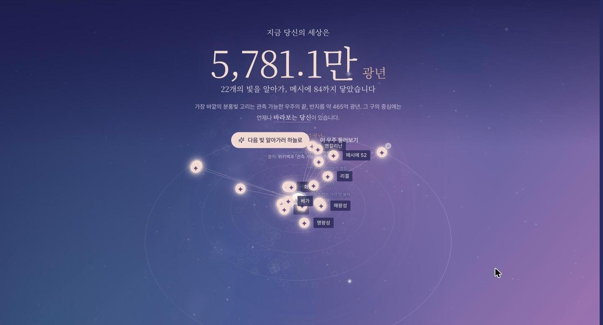
/// caption
'우주 끝까지 떠나 보기'의 마지막 장면입니다. "지금 당신의 세상은 5,781.1만 광년"이라는 문장 아래에 관측 가능한 우주의 끝(반지름 약 465억 광년)과 "그 구의 중심에는 언제나 바라보는 당신이 있습니다"라는 문장이 있습니다
///

여정이 끝나면 지금 내 세상의 크기와 알아간 빛의 수가 나옵니다. 그리고 가장 바깥의 분홍빛 고리가 반지름 약 465억 광년인 관측 가능한 우주의 끝이라고 알려 줍니다. 화면의 마지막 문장은 다음과 같습니다.

!!! quote "여정의 마지막 문장"
    그 구의 중심에는 언제나 바라보는 당신이 있습니다

우주가 아무리 넓어도 그 넓이를 재는 기준은 지금 바라보는 나라는 점을 이 장면의 마지막에 남기고 싶었습니다.

### 빛의 편지

빛의 편지는 지금 나에게 닿은 빛이 출발했을 때 지구에서는 무슨 일이 있었는지 알려 주는 편지입니다. 천체를 골라 받는 편지와, "내가 태어날 무렵 출발한 빛"처럼 나이로 찾는 편지 두 가지가 있습니다.

편지는 빛이 출발한 해의 지구 기록, 즉 위키 문서 가운데 그 연도를 다루는 문서를 근거로 씁니다. 그래서 빛이 수백 년 전에 떠난 천체와 몇 시간 전에 떠난 천체는 편지에 담기는 내용이 서로 다릅니다. 두 편지를 차례로 보여 드리겠습니다.

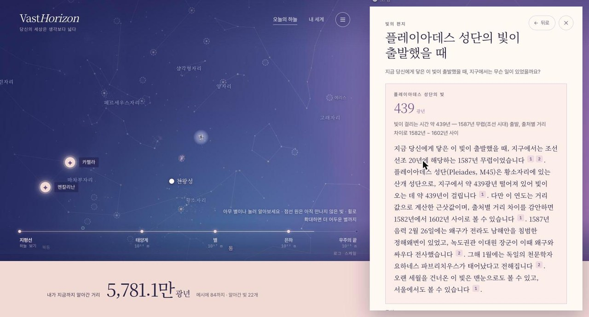
/// caption
플레이아데스 성단의 빛으로 받은 빛의 편지입니다. 거리 439광년과 빛이 걸리는 시간 약 439년, 1587년 무렵(조선 시대)이라는 출발 시기와 출처별 거리 차이를 감안한 1582년 ~ 1602년 범위를 보여 주고, 편지 본문의 문장마다 근거 번호가 붙어 있습니다
///

플레이아데스 성단(M45)은 황소자리에 있는 산개 성단으로, 지구에서 약 439광년 떨어져 있습니다. 그래서 지금 나에게 닿은 이 성단의 빛은 약 439년 전인 1587년 무렵, 조선 선조 20년에 출발했습니다.

편지에는 그해에 지구에서 있었던 일이 근거 번호와 함께 들어갑니다. 1587년 음력 2월 26일에는 왜구가 전라도 남해안을 침범한 정해왜변이 있었고, 녹도권관 이대원 장군이 이때 왜구와 싸우다 전사했습니다. 같은 해 1월에는 독일의 천문학자 요하네스 파브리치우스가 태어났다고 전해집니다.

다만 1587년이라는 연도는 거리 값으로 계산한 근삿값입니다. 그래서 편지는 출처마다 거리 값이 다르다는 점을 감안해, 빛이 출발한 해를 1582년에서 1602년 사이로 볼 수 있다는 범위도 함께 밝힙니다. 편지의 마지막 문장은 오랜 세월을 건너온 이 빛을 맨눈으로도, 서울에서도 볼 수 있다고 알려 줍니다.

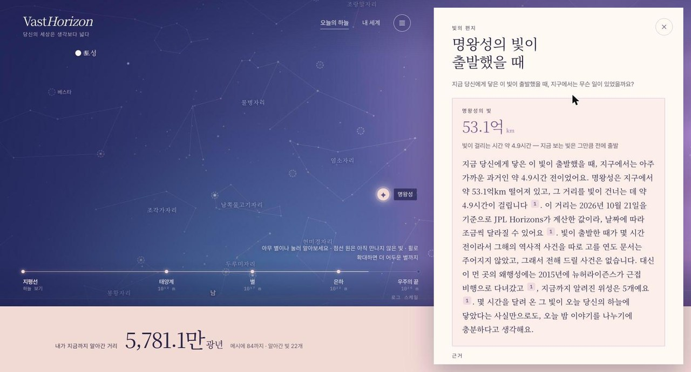
/// caption
명왕성의 빛으로 받은 빛의 편지입니다. 명왕성까지의 거리 53.1억 km와 빛이 걸리는 시간 약 4.9시간을 보여 주고, 편지 본문의 문장마다 근거 번호가 붙어 있습니다
///

명왕성으로 편지를 받으면 먼저 명왕성이 지구에서 약 53.1억 km 떨어져 있고, 그 거리를 빛이 건너는 데 약 4.9시간이 걸린다는 사실을 알려 줍니다.

플레이아데스 성단처럼 광년 단위로 멀리 떨어진 천체는 빛이 출발한 해의 역사적 사실이 편지에 들어갑니다. 하지만 명왕성의 빛은 몇 시간 전에 떠났기 때문에 편지의 근거가 될 연도 문서가 없고, 그래서 명왕성의 편지에는 역사적 사건이 들어가지 않습니다. 이처럼 빛이 도달하는 시간이 짧은 천체는 2015년에 뉴허라이즌스가 근접 비행으로 명왕성을 다녀갔다는 사실처럼, 근거가 있는 다른 이야기로 편지를 채웁니다.

저는 명왕성의 편지가 이 서비스의 원칙을 잘 보여 준다고 생각합니다. 그럴듯한 사건을 하나 지어내 붙였다면 편지는 더 감동적으로 보였을 것입니다. 하지만 근거 문서가 없으면 없다고 말하고, 그 대신 확인된 사실만으로 편지를 쓰게 했습니다. 플레이아데스 성단의 편지에서 연도의 범위를 함께 밝힌 것도 같은 이유입니다.

받은 편지는 보관함에 쌓입니다. 아직 열지 않은 편지가 있으면 천체 서랍의 도착 편지 카드와 상단 알림, 메뉴의 배지, 지도의 ✉ 표식으로 알려 줍니다. 이 표식은 읽지 않은 편지가 있으면 또렷하게 보이고, 모두 읽었으면 흐리게 보입니다.

### 마음 한 줄

마음 한 줄은 위로라는 목표에 가장 가까운, 이 서비스의 핵심 기능입니다. 지금의 마음을 한 줄로 적거나 버튼으로 고르면, 서비스는 그 곁에 우주의 사실을 근거로 한 위로의 말을 건넵니다.

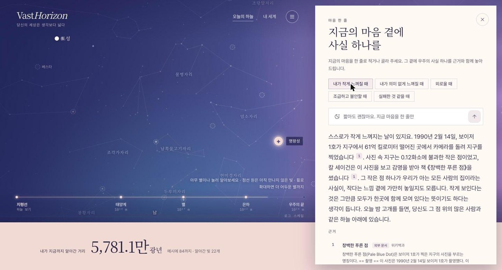
/// caption
마음 한 줄 화면입니다. "내가 작게 느껴질 때"를 포함한 버튼 다섯 개가 있고, 그 가운데 "내가 작게 느껴질 때"를 눌러 받은 창백한 푸른 점 이야기와 아래쪽 근거가 보입니다
///

"내가 작게 느껴질 때"를 누르면 1990년 2월 14일에 보이저 1호가 61억 킬로미터 떨어진 곳에서 지구를 찍은 사진, 즉 창백한 푸른 점에 대한 이야기가 근거와 함께 돌아옵니다. 이 답은 다음 네 단으로 구성되어 있습니다.

1. 첫 문장은 판단 없이 그 마음을 받아 줍니다.
2. 다음 한두 문장은 장면이 떠오르도록 사실을 전합니다. 근거 번호는 이 부분에만 붙습니다.
3. 그다음 두 문장은 "~일지도 모릅니다" 같은 열린 어미로 그 사실을 지금의 마음과 잇습니다.
4. 마지막 한 문장은 "오늘 밤", "고개를 들면" 같은 말로 지금 이 사람에게 돌아옵니다.

사실과 마음을 이을 때는 "사실로 마음을 작게 만들지 않는다"는 규칙을 지키게 했습니다. 우주가 넓다는 사실을 들어 "그에 비하면 당신의 고민은 사소하다"고 말하는 답은 금지했습니다.

그 대신 주제마다 사실을 마음과 잇는 방향을 정해 두었습니다. 작게 느껴질 때에는 창백한 푸른 점 속에 모든 사람이 함께 있다는 쪽으로 잇고, 실패한 것 같을 때에는 고장 난 망원경이 고쳐지고 실패한 임무가 돌아왔다는 쪽으로 잇습니다.

이 기능은 위로를 건네지만 상담을 대신하지는 않습니다. 화면에는 "VastHorizon은 전문 심리상담을 대신하지 않습니다"라는 문장을 두었고, 위기를 뜻하는 표현이 들어오면 답보다 상담 창구 안내를 먼저 보여 줍니다.

### 조건 탐색

조건 탐색은 거리나 종류, 맨눈 관측 여부처럼 확인할 수 있는 조건으로 천체를 찾는 기능입니다.

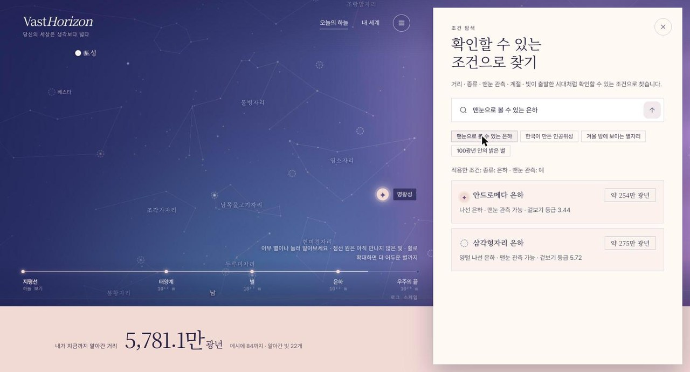
/// caption
"맨눈으로 볼 수 있는 은하"로 찾은 결과입니다. 적용한 조건(종류: 은하 · 맨눈 관측: 예) 아래에 안드로메다 은하와 삼각형자리 은하가 거리, 겉보기 등급과 함께 나옵니다
///

"맨눈으로 볼 수 있는 은하"라고 입력하면 화면은 다음 순서로 결과를 보여 줍니다.

- 먼저 "적용한 조건: 종류: 은하 · 맨눈 관측: 예"를 표시합니다.
- 그 조건에 맞는 안드로메다 은하와 삼각형자리 은하를 찾아 보여 줍니다.

자연어 질문을 어떤 조건으로 바꿨는지 그대로 보여 주기 때문에 사용자는 결과가 왜 이렇게 나왔는지 직접 확인할 수 있습니다.

### 오늘 밤 내 빛, 두 눈으로 본 빛, 하늘 가리키기

화면 속에서 알아 간 빛을 실제 밤하늘에서도 만날 수 있게 하는 기능도 만들었습니다. '오늘 밤 내 빛'은 내 세계에 담은 천체 가운데 오늘 밤 이 자리에서 볼 수 있는 천체와, 그 천체를 보기에 가장 좋은 시간대를 알려 줍니다.

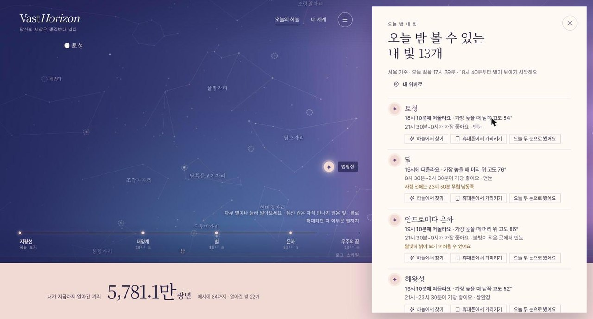
/// caption
서울 기준으로 계산한 '오늘 밤 볼 수 있는 내 빛 13개'입니다. 토성은 18시 10분에 떠올라 21시 30분~0시가 가장 좋고 맨눈으로 볼 수 있다고 안내하며, 안드로메다 은하에는 달빛이 밝아 보기 어려울 수 있다는 경고가 붙어 있습니다
///

계산은 모두 브라우저에서 합니다. 계산 규칙은 다음과 같습니다.

- 태양의 고도로 밤인지 판정합니다. 밝은 천체는 덜 어두운 하늘에서도 보이기 때문에 밝기에 따라 기준을 다르게 둡니다.
- 겉보기 등급에 따라 맨눈, 불빛이 적은 곳에서 맨눈, 쌍안경, 망원경을 구분합니다.
- 다음 새벽까지 10분 간격으로 고도를 계산하고, 가장 높이 뜨는 때의 앞뒤 1시간을 추천합니다.
- 달 가까이에 있는 천체에는 달빛의 영향을 고려합니다.
- 인공위성은 지나가는 시각이 날마다 달라 아직 안내하지 못한다고 솔직하게 적었습니다.

천체를 실제로 봤다면 하루에 한 번 '오늘 두 눈으로 봤어요'를 눌러 기록할 수 있습니다. 기록에는 날짜만 남기고, 위치는 약 11km 단위까지만 저장합니다. 두 눈으로 본 천체는 지도와 목록에서 금빛 두 겹 표식으로 구분되어 보입니다.

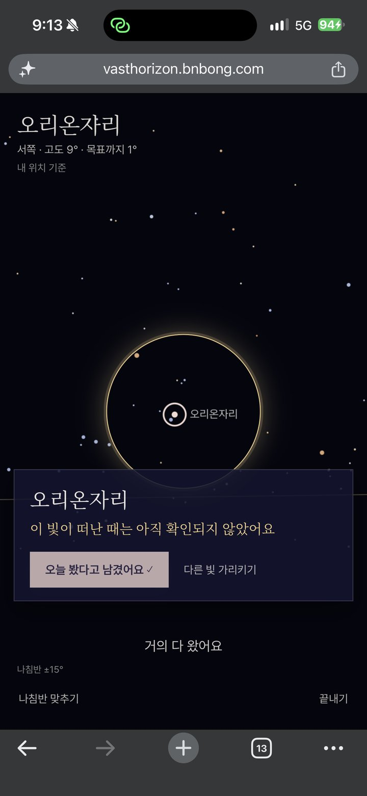
/// caption
휴대폰에서 오리온자리를 가리킨 화면입니다. 서쪽 고도 9°에 있는 목표까지 1° 남은 상태로, 금빛 원 안에 들어오자 "거의 다 왔어요"라는 안내와 함께 '오늘 봤다고 남겼어요' 기록이 켜졌습니다. 별자리라서 빛이 떠난 때는 아직 확인되지 않았다고 알립니다
///

'휴대폰에서 가리키기'를 누르고 휴대폰을 하늘로 들어 올리면, 기기의 방향 센서로 휴대폰이 향한 방위와 고도를 구합니다. 그리고 그 천체가 있는 쪽을 화살표와 글로 안내합니다. 휴대폰이 천체를 향하면 소리와 진동이 울리고, 그 빛이 떠난 때를 알려 줍니다.

나침반의 자기 편각을 보정하고, 근처의 밝은 별도 함께 그려서 지금 어디를 보고 있는지 알 수 있게 했습니다. 센서가 없거나 사용자가 권한을 거부한 기기에서는 "남서쪽, 주먹 4개 높이"처럼 글로 방향을 알려 줍니다.

### 공유하고, 읽어 주고, 휴대폰에서도

이 밖에도 받은 편지를 링크와 이미지로 공유하거나 카카오톡으로 보낼 수 있습니다. 편지는 Google Cloud TTS 서버 음성으로 읽어 주고, 서버 음성을 쓸 수 없으면 기기 음성으로 대신 읽습니다.

Google Cloud TTS 서버는 무료 플랜에서도 쓸 수 있는 사용량이 넉넉해서 채택했습니다. 다만 생각만큼 한국어를 잘 읽지는 못하는 것 같아서 지금은 다른 TTS 서버를 찾아보고 있습니다.

휴대폰에서는 화면 구성을 다시 설계했습니다. 천체를 고르면 3D 근접 뷰가 무대에 뜨고, 설명은 세 단계 높이에 멈추는 바텀시트에 담깁니다.

## 설계는 프로젝트 글로

이 글은 화면을 중심으로 적었기 때문에 설계 이야기는 짧게만 남기겠습니다. 다음 내용은 프로젝트 소개 글에 표와 함께 정리해 두었습니다.

- 천체 하나의 범위 안에서만 근거를 찾는 검색 구조와 인용 검증
- 청킹과 top-k를 정한 실험
- 배포 서버에서 임베딩 모델을 바꾼 이유
- 비용 통제와 배포 파이프라인

<https://bnbong.com/projects/vasthorizon/>

## AI와 함께 만든 과정

이 프로젝트도 Claude Code로 구현했습니다. 저장소의 커밋 대부분에 `Co-Authored-By: Claude Fable 5.1` 줄이 붙어 있습니다. 과제 기간에는 요구사항 번호 단위로 기능을 구현하고 커밋했습니다.

구현한 코드는 Codex(GPT)에게 리뷰를 받은 뒤 그 내용을 다시 반영했습니다. 배포 코드와 프론트 코드에 대한 리뷰를 반영한 커밋이 있고, 하늘 가리키기 커밋 본문에도 "Codex 리뷰 반영" 항목이 따로 있습니다.

그 항목에는 위치마다 시간대를 따로 적용하고, 새벽을 경계로 하룻밤의 관측을 하나로 묶는 처리가 들어 있습니다. 이렇게 한 모델이 만든 코드를 다른 계열의 모델이 리뷰하게 해서, 혼자 개발하면서도 다른 시각으로 코드를 점검하는 단계를 두었습니다.

이 작업 방식은 [SSAFY 발표 정리 글](https://bnbong.com/blog/20261025-ssafy-ai-orchestration-talk/)에 자세히 적어 두었습니다.

## 후기와 앞으로

3일짜리 과제로 시작한 프로젝트가 공개 서비스가 되는 동안, 과제 산출물에 요구되는 것과 공개 서비스에 요구되는 것이 생각보다 많이 다르다는 점을 느꼈습니다. 과제에서는 요구사항을 충족했다는 사실을 보여 주는 것이 중요했습니다. 공개 서비스에서는 처음 들어온 사람이 답을 제때 받는지, 비용이 예상 밖으로 늘지 않는지, 휴대폰에서도 쓸 수 있는지가 먼저였습니다.

그래도 과제 첫날 정한 원칙은 바꾸지 않았습니다. "위로를 지어내지 않습니다. 사실로 위로합니다."라는 문장은 RAG 전후 비교에서 "확인 불가"라고 답한 결과를 받아들이는 기준이 되었습니다. 그 뒤로도 이 원칙은 다음 선택으로 이어졌습니다.

- 블랙홀 카드에 상상도라는 안내를 붙였습니다.
- 명왕성의 편지에 전해 드릴 사건이 없다고 적었습니다.
- 인공위성의 관측 시각은 아직 안내하지 못한다고 밝혔습니다.

개인적으로는 은하 중심 블랙홀을 계산으로 그린 화면이 가장 마음에 듭니다. 이 서비스의 출발점이 된 생각을 블랙홀에 대한 대화에서 얻었는데, 이제는 그 블랙홀을 근거와 안내문을 붙여 화면에서도 보여 줄 수 있게 되었습니다.

앞으로는 휴대폰 화면을 여러 실기기에서 검증할 예정입니다. 바텀시트 제스처와 성능을 점검해야 하고, 하늘 가리키기도 기기마다 센서가 다르게 동작할 수 있어 실제 기기에서 확인해야 합니다. RAG 2단계 작업은 실제 사용량이 쌓인 뒤에 무엇이 필요한지 살펴보고 정하겠습니다.

오늘 밤 고개를 들 일이 있다면, VastHorizon으로 빛 하나를 알아 가 보시기 바랍니다.

<https://vasthorizon.bnbong.com>
