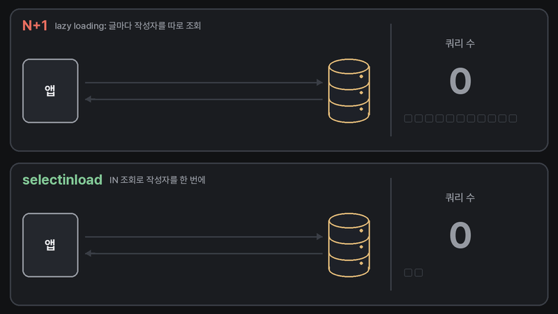
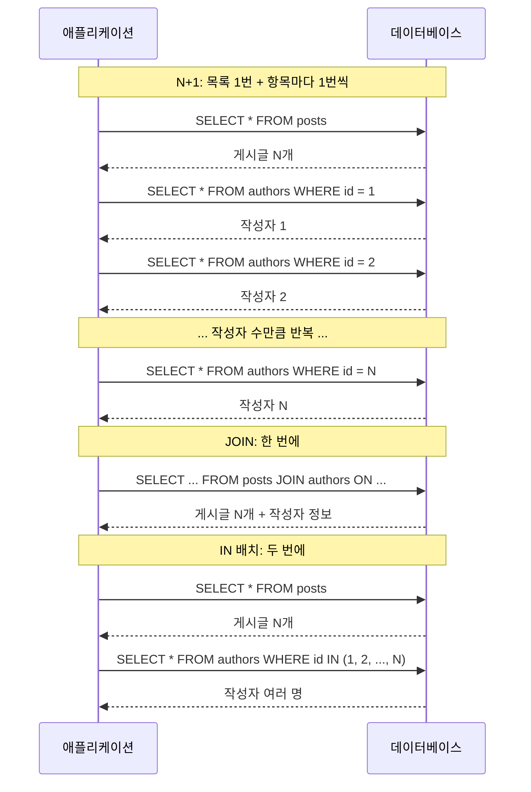
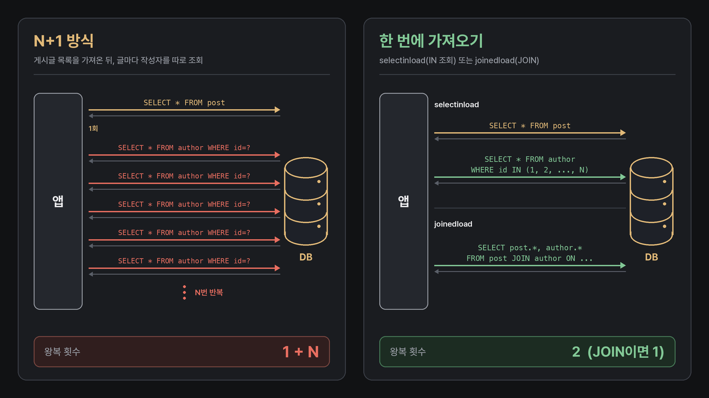

## 들어가며

ORM을 쓰는 백엔드 코드에서 가장 자주 언급되는 성능 문제 중 하나가 N+1 문제입니다. 이름은 많이 들어 봤어도, 코드 어디에서 왜 생기는지 한 번에 설명하기는 생각보다 어렵습니다.

저는 주로 FastAPI와 SQLAlchemy로 Python 백엔드를 만들고, Spring Boot와 JPA도 함께 다룹니다. 두 환경을 오가다 보니 N+1이 특정 프레임워크의 문제가 아니라 ORM이 데이터를 가져오는 방식에서 생기는 문제라는 점을 정리해 두고 싶었습니다.

이 글은 N+1 문제를 처음 접하는 백엔드 입문자를 독자로 생각하고 썼습니다. 비유로 개념을 먼저 잡고, 그다음 Spring Boot JPA와 FastAPI(SQLAlchemy)에서 실제로 쿼리 로그를 찍어 보면서 발생과 해결을 확인합니다.

결론부터 적으면 다음과 같습니다.

- N+1은 ==목록을 가져오는 쿼리 1번== 뒤에, 목록의 각 항목에 딸린 데이터를 가져오는 쿼리가 ==항목 수(N)만큼 따로== 나가는 현상입니다.
- 원인은 프레임워크가 아니라 연관 데이터를 항목마다 개별 SELECT로 가져오는 ORM의 조회 방식입니다. 지연 로딩(lazy loading)이 가장 흔한 경우이고, 즉시 로딩도 같은 방식으로 쿼리를 보낼 수 있습니다. 그래서 Spring Boot에서도, FastAPI에서도 똑같이 생깁니다.
- 해결 방법은 "필요한 연관 데이터를 처음 조회할 때 함께 가져오라고 ORM에 알려 주는 것"입니다. JOIN으로 한 번에 가져오거나, IN 조건으로 한 번 더 묶어서 가져옵니다.

---

## 비유로 이해하기: 동아리 이름을 묻는 선생님

학교 축제를 준비하는 선생님이 있다고 가정해 보겠습니다. 선생님은 참가 학생 명단을 보고, 학생마다 소속 동아리 이름을 적은 안내문을 만들어야 합니다.

그런데 교무실에서 받은 학생 명단에는 학생 이름과 ==동아리 번호==만 적혀 있습니다. 동아리 이름을 알려면 동아리 담당 부서에 따로 물어봐야 합니다.

**방법 A: 학생 한 명마다 전화하기**

1. 교무실에 전화해 학생 명단을 받습니다. (전화 1번)
2. 명단의 첫 번째 학생을 보고 동아리 담당 부서에 전화해 "3번 동아리 이름이 뭔가요?"라고 묻습니다.
3. 두 번째 학생을 보고 다시 전화합니다. 세 번째 학생도, 네 번째 학생도 마찬가지입니다.

학생이 N명이면 전화는 1 + N번 걸립니다. 학생이 30명이면 31번, 300명이면 301번입니다. 통화 한 번 한 번은 짧더라도, 전화를 걸고 연결을 기다리고 끊는 과정이 매번 반복됩니다.

**방법 B: 처음부터 묶어서 받기**

- 교무실에 "학생 명단에 동아리 이름까지 붙여서 주세요"라고 한 번에 요청합니다. (전화 1번)
- 또는 명단을 받은 뒤, 명단에 나온 동아리 번호를 모아 "1, 2, 3, 4, 5번 동아리 이름을 한꺼번에 알려 주세요"라고 한 번 더 묻습니다. (전화 2번)

어느 쪽이든 전화 횟수가 학생 수에 비례해 늘어나지 않습니다. 한 번에 물어볼 수 있는 동아리 수에 한도가 있다면 몇 번 더 나눠 묻는 정도입니다.



/// caption
방법 A는 요청이 1 + N번 차례로 오가고, 방법 B는 두 번(JOIN이면 한 번)에 필요한 데이터를 모두 받습니다. 애니메이션은 게시글 10개의 작성자가 모두 다른 경우(N = 10)를 기준으로 그렸습니다.
///

이 비유를 데이터베이스에 그대로 옮기면 다음과 같습니다.

| 비유 | 데이터베이스 |
| --- | --- |
| 선생님 | 애플리케이션 서버 |
| 교무실, 동아리 담당 부서 | 데이터베이스 |
| 전화 한 통 | 쿼리 한 번(네트워크 왕복 한 번) |
| 학생 명단 | 게시글 목록(`posts`) |
| 동아리 이름 | 게시글 작성자 정보(`authors`) |
| 방법 A | N+1 |
| 방법 B | JOIN 또는 IN 쿼리로 묶어서 가져오기 |

---

## 실제로 무슨 일이 일어나는가

이제 비유를 걷어내고 실제 상황을 보겠습니다. 게시글(`Post`) 목록 화면에서 게시글 제목과 작성자(`Author`) 이름을 함께 보여 주는 API를 생각해 보겠습니다. 게시글 여러 개가 작성자 한 명에게 속하는 다대일 관계입니다.

ORM으로 이 화면을 만들면 코드는 보통 이런 모양이 됩니다.

```python
posts = 게시글_전체_조회()
for post in posts:
    print(post.title, post.author.name)
```

코드만 보면 조회는 첫 줄에서 한 번만 하는 것처럼 보입니다. 하지만 지연 로딩(lazy loading)으로 설정된 ORM에서 `post.author`는 처음 읽는 순간에 비로소 데이터베이스에서 가져오는 속성입니다.

SQLAlchemy의 관계와 JPA의 `@OneToMany`는 기본값이 지연 로딩입니다. 그래서 반복문이 돌 때마다 작성자를 조회하는 쿼리가 따로 나갑니다.



/// caption
N+1 방식과 JOIN, IN 배치 방식에서 애플리케이션과 데이터베이스가 주고받는 요청
///



/// caption
N+1 방식은 데이터가 늘어날수록 쿼리 수가 함께 늘어나고, JOIN은 1번, 배치 조회는 2번으로 끝납니다. 그림의 횟수는 연관 데이터가 배치 크기 안에 들어오는 경우 기준이고, 배치 크기를 넘으면 IN 쿼리가 그만큼 나뉩니다.
///

### 왜 문제인가

쿼리 하나하나는 대부분 기본 키로 한 행을 찾는 단순한 쿼리이므로 그 자체로는 빠릅니다. 문제는 ==쿼리 횟수가 데이터 개수에 비례해서 늘어난다==는 점입니다.

- **왕복 비용이 쌓입니다.** 쿼리 한 번에는 SQL 실행 시간뿐 아니라 애플리케이션과 데이터베이스 사이의 네트워크 왕복, 드라이버의 요청 직렬화와 응답 해석, 데이터베이스의 쿼리 처리 준비 비용이 함께 들어갑니다. 쿼리 하나는 가볍더라도 N개가 순서대로 실행되면 이 비용이 N번 더해집니다.
- **개발 환경에서는 잘 보이지 않습니다.** 로컬 데이터베이스에 테스트 데이터가 열 건 정도라면 쿼리 열한 번은 체감되지 않습니다. 운영 데이터가 쌓이고 한 페이지에 보여 주는 항목이 늘어나면, 같은 코드가 쿼리 수백 번을 보내게 됩니다.
- **커넥션을 오래 붙잡습니다.** 반복문이 쿼리를 하나씩 보내는 동안 그 요청은 커넥션 풀에서 꺼낸 커넥션 하나를 계속 점유합니다. 요청 하나가 커넥션을 오래 쥐고 있으면 동시에 들어온 다른 요청이 커넥션을 기다리게 되고, 트래픽이 몰릴 때 전체 응답 시간이 함께 늘어납니다.

이 글의 예제는 모두 인메모리 데이터베이스(SQLite, H2)에서 실행했기 때문에 네트워크 왕복 비용이 사실상 없어서 실행 시간 수치는 따로 적지 않고, ==쿼리가 몇 번 나가는지==만 확인합니다.

실제 서비스처럼 데이터베이스가 다른 서버에 있으면 쿼리 수의 차이가 그대로 응답 시간의 차이로 이어집니다.

---

## Spring Boot JPA에서 발생하는 경우

먼저 Spring Boot와 JPA(Hibernate)에서 확인해 보겠습니다. 아래 예제는 Spring Boot 3.5.6(Hibernate 6.6.29, Spring Data JPA 3.5.4), H2 2.3.232, OpenJDK 21 환경에서 직접 실행했습니다. 작성자 5명이 게시글을 2개씩, 모두 10개를 갖도록 데이터를 넣었습니다.

### 엔티티와 지연 로딩

```java
@Entity
public class Author {
    @Id @GeneratedValue
    private Long id;

    private String name;

    @OneToMany(mappedBy = "author")
    private List<Post> posts = new ArrayList<>();

    // 생성자, getter 생략
}

@Entity
public class Post {
    @Id @GeneratedValue
    private Long id;

    private String title;

    @ManyToOne(fetch = FetchType.LAZY)
    private Author author;

    // 생성자, getter 생략
}
```

`@OneToMany`는 기본값이 지연 로딩(`LAZY`)입니다. 반면 `@ManyToOne`은 JPA 기본값이 즉시 로딩(`EAGER`)이기 때문에, 위 코드처럼 `fetch = FetchType.LAZY`를 명시하는 것이 일반적인 권장 사항입니다. 이유는 뒤에서 다시 설명하겠습니다.

### 컬렉션을 순회할 때 생기는 N+1

작성자 목록을 조회한 뒤, 작성자마다 게시글 수를 출력하는 코드입니다. 실행할 때는 `TransactionTemplate`으로 감싼 트랜잭션 안에서 돌렸습니다.

```java
tx.executeWithoutResult(status -> {
    for (Author author : authorRepository.findAll()) {
        System.out.println(author.getName() + " " + author.getPosts().size());
    }
});
```

`logging.level.org.hibernate.SQL=debug`로 실행한 SQL을 출력하면 다음과 같습니다.

```text
select a1_0.id,a1_0.name from author a1_0
select p1_0.author_id,p1_0.id,p1_0.title from post p1_0 where p1_0.author_id=?
author1 2
select p1_0.author_id,p1_0.id,p1_0.title from post p1_0 where p1_0.author_id=?
author2 2
select p1_0.author_id,p1_0.id,p1_0.title from post p1_0 where p1_0.author_id=?
author3 2
select p1_0.author_id,p1_0.id,p1_0.title from post p1_0 where p1_0.author_id=?
author4 2
select p1_0.author_id,p1_0.id,p1_0.title from post p1_0 where p1_0.author_id=?
author5 2
```

작성자 목록 쿼리 1번 뒤에, `author.getPosts()`를 처음 읽을 때마다 게시글 쿼리가 1번씩, 모두 5번 더 나갔습니다. 작성자가 5명이므로 1 + 5 = 6번입니다.

반대 방향인 `@ManyToOne`에서도 같은 일이 생깁니다. 게시글 목록을 조회한 뒤 `post.getAuthor().getName()`을 읽으면, 작성자를 기본 키로 조회하는 쿼리가 반복해서 나갑니다.

```text
select p1_0.id,p1_0.author_id,p1_0.title from post p1_0
select a1_0.id,a1_0.name from author a1_0 where a1_0.id=?
post1-a author1
post1-b author1
select a1_0.id,a1_0.name from author a1_0 where a1_0.id=?
post2-a author2
post2-b author2
...
```

여기서 쿼리가 게시글 수(10)가 아니라 작성자 수(5)만큼 나간 점을 눈여겨볼 만합니다.

JPA는 한 트랜잭션 안에서 이미 불러온 엔티티를 영속성 컨텍스트에 보관해 두기 때문에, `post1-b`의 작성자는 `post1-a`를 처리할 때 가져온 `author1`을 다시 씁니다. 비유로 말하면, 선생님이 이미 물어본 동아리 이름은 메모해 두었다가 다시 전화하지 않는 셈입니다.

그래서 N+1에서 N은 정확히 말하면 "추가 조회가 필요한 연관 데이터의 건수"이고, 이미 불러온 데이터는 여기서 빠집니다. 앞의 `@OneToMany` 예제에서는 작성자마다 게시글 컬렉션 하나씩 5건이었고, 이 예제에서는 서로 다른 작성자 5명이었습니다.

`@ManyToOne`을 기본값인 `EAGER`로 두면 문제가 사라지는 것이 아니라 시점만 앞당겨집니다.

`fetch = FetchType.LAZY`를 지우고 같은 코드를 실행해 보면, `findAll()`이 반환되는 시점에 작성자 쿼리 5번이 반복문보다 먼저 한꺼번에 나갔습니다. `findAll()`은 게시글 목록만 조회한 뒤, 즉시 로딩 설정을 지키려고 작성자를 개별 쿼리로 채우기 때문입니다.

즉시 로딩은 작성자가 필요 없는 화면에서도 이 쿼리를 보내므로, 연관 관계는 `LAZY`로 두고 필요한 곳에서만 함께 가져오는 방식이 관리하기 쉽습니다.

### 해결 1: fetch join

JPQL의 `join fetch`는 연관 엔티티를 JOIN으로 함께 조회해서 한 번에 채우라는 뜻입니다.

```java
public interface AuthorRepository extends JpaRepository<Author, Long> {

    @Query("select a from Author a join fetch a.posts")
    List<Author> findAllWithPosts();
}
```

```text
select a1_0.id,a1_0.name,p1_0.author_id,p1_0.id,p1_0.title from author a1_0 join post p1_0 on a1_0.id=p1_0.author_id
```

쿼리가 1번으로 줄었습니다. JOIN 결과는 게시글 수만큼 10행이 나오지만, Hibernate 6부터는 같은 엔티티를 결과에서 자동으로 합쳐 주기 때문에 반환된 `Author`는 5개였습니다.

Hibernate 5 이하에서는 같은 작성자가 중복으로 담기는 것을 막으려고 `select distinct`를 붙이는 관례가 있었습니다.

`join fetch`는 내부 조인이므로 게시글이 하나도 없는 작성자는 결과에서 빠집니다. 그런 작성자도 포함해야 한다면 `left join fetch`를 씁니다.

### 해결 2: `@EntityGraph`

JPQL을 직접 쓰지 않고, 어떤 연관 관계를 함께 가져올지 애너테이션으로 지정하는 방법입니다.

```java
@EntityGraph(attributePaths = "posts")
@Query("select a from Author a")
List<Author> findAllWithPostsGraph();
```

```text
select a1_0.id,a1_0.name,p1_0.author_id,p1_0.id,p1_0.title from author a1_0 left join post p1_0 on a1_0.id=p1_0.author_id
```

fetch join과 마찬가지로 쿼리는 1번이지만, 생성된 SQL이 `join`이 아니라 `left join`이라는 점이 다릅니다. 그래서 게시글이 없는 작성자도 결과에 포함됩니다.

`@EntityGraph`는 Spring Data JPA의 메서드 이름 쿼리(`findByName` 같은 메서드)에도 붙일 수 있어서, 쿼리를 직접 쓰지 않는 코드에서 편리합니다.

### 해결 3: `@BatchSize`와 `default_batch_fetch_size`

세 번째 방법은 JOIN을 쓰지 않고, 지연 로딩이 일어날 때 여러 건을 IN 조건으로 묶어서 가져오게 하는 것입니다. 비유의 방법 B 중 "동아리 번호를 모아서 한 번에 묻기"에 해당합니다.

전역으로 적용하려면 설정에 아래 한 줄을 추가합니다.

```properties
spring.jpa.properties.hibernate.default_batch_fetch_size=100
```

특정 연관 관계에만 적용하려면 Hibernate의 `@BatchSize`를 붙입니다.

```java
@BatchSize(size = 100)
@OneToMany(mappedBy = "author")
private List<Post> posts = new ArrayList<>();
```

이렇게 설정하고 처음의 `findAll()` 코드를 그대로 실행하면 다음과 같이 쿼리가 2번으로 줄어듭니다.

```text
select a1_0.id,a1_0.name from author a1_0
select p1_0.author_id,p1_0.id,p1_0.title from post p1_0 where p1_0.author_id in (?,?,?,?, ... ,?)
```

이번 실행 환경(Hibernate 6.6, H2)에서는 실제 작성자가 5명인데도 `in` 안의 자리 표시자가 설정한 크기만큼 100개 생성됐습니다.

바인딩 로그(`logging.level.org.hibernate.orm.jdbc.bind=trace`)를 켜 보면 앞의 5자리에 작성자 ID가 들어가고 남는 자리에는 `null`이 바인딩되므로, 결과에는 영향이 없습니다.

조회 코드를 고치지 않아도 되므로, 이미 지연 로딩으로 짜인 코드가 많을 때 먼저 적용해 보기 좋은 방법입니다.

### 세 방식의 차이

| 방식 | 쿼리 수 | 생성 SQL | 특징 |
| --- | --- | --- | --- |
| 지연 로딩 그대로 | 1 + N | 목록 SELECT + `where id=?` N번 | 필요할 때만 가져오지만 반복문에서 N+1 |
| fetch join | 1 | `join` | JPQL로 명시, 연관 데이터가 없는 행은 빠짐 |
| `@EntityGraph` | 1 | `left join` | 애너테이션으로 지정, 메서드 이름 쿼리에도 적용 |
| 배치 크기 설정 | 1 + 1 | 목록 SELECT + `in (...)` 1번 | 기존 코드 수정 없이 적용, 배치 크기를 넘으면 쿼리가 나뉨 |

### 주의할 점

- `List` 타입 컬렉션 두 개 이상을 한 쿼리에서 동시에 fetch join하면 Hibernate가 `MultipleBagFetchException`을 던집니다. 이럴 때는 컬렉션 하나만 fetch join하고 나머지는 배치 크기 설정으로 가져오는 조합을 많이 씁니다.
- 컬렉션을 fetch join하면서 페이지네이션(`Pageable`)을 함께 쓰면, Hibernate는 데이터베이스에서 전체 결과를 가져온 뒤 메모리에서 페이지를 자른다는 경고를 남깁니다. 데이터가 많으면 이 방식은 위험하므로, 컬렉션은 배치 크기 설정으로 가져오는 편이 안전합니다.

---

## Python에서도 발생하는가

==넹== 

N+1 문제는 데이터베이스에 쿼리를 보내는 시점을 ORM이 정하는 데서 생기는 경우가 많습니다. 그래서 SQLAlchemy처럼 지연 로딩을 지원하는 ORM을 쓰면 Spring Boot와 똑같은 구조로 N+1이 생깁니다.

아래 예제는 Python 3.12.4, SQLAlchemy 2.1.6, aiosqlite 0.22.1, greenlet 3.5.6, Pydantic 2.14.2 환경에서 직접 실행했습니다. 데이터는 작성자 5명과 게시글 10개이고, 게시글은 작성자에게 차례대로 2개씩 배정했습니다.

### 모델

```python
from sqlalchemy import ForeignKey
from sqlalchemy.orm import DeclarativeBase, Mapped, mapped_column, relationship


class Base(DeclarativeBase):
    pass


class Author(Base):
    __tablename__ = "authors"
    id: Mapped[int] = mapped_column(primary_key=True)
    name: Mapped[str]
    posts: Mapped[list["Post"]] = relationship(back_populates="author")


class Post(Base):
    __tablename__ = "posts"
    id: Mapped[int] = mapped_column(primary_key=True)
    title: Mapped[str]
    author_id: Mapped[int] = mapped_column(ForeignKey("authors.id"))
    author: Mapped[Author] = relationship(back_populates="posts")
```

SQLAlchemy의 `relationship()`은 별도 설정이 없으면 `lazy="select"`, 즉 지연 로딩으로 동작합니다.

### 동기 세션에서 생기는 N+1

엔진을 `create_engine("sqlite://", echo=True)`처럼 `echo=True`로 만들면 실행되는 SQL이 로그로 출력됩니다.

```python
with Session(engine) as session:
    posts = session.scalars(select(Post)).all()  # 쿼리 1번
    for post in posts:
        print(post.title, post.author.name)  # 작성자마다 쿼리 1번씩
```

로그에서 SQL 부분만 발췌하면 다음과 같습니다.

```text
SELECT posts.id, posts.title, posts.author_id
FROM posts
SELECT authors.id, authors.name
FROM authors
WHERE authors.id = ?
[generated in 0.00007s] (1,)
post1 author1
SELECT authors.id, authors.name
FROM authors
WHERE authors.id = ?
[cached since 0.0003839s ago] (2,)
post2 author2
...
SELECT authors.id, authors.name
FROM authors
WHERE authors.id = ?
[cached since 0.0009317s ago] (5,)
post5 author5
post6 author1
post7 author2
```

게시글 목록 쿼리 1번 뒤에 작성자 쿼리가 5번 나갔습니다.

`post6`부터는 쿼리가 나가지 않았는데, JPA의 영속성 컨텍스트처럼 SQLAlchemy의 세션도 이미 불러온 객체를 identity map에 보관하고 다대일 관계를 읽을 때 먼저 그곳을 찾아보기 때문입니다.

여기서도 N은 새로 조회해야 하는 작성자의 수입니다.

로그의 `[cached since ...]`는 SQL 문자열을 컴파일한 결과를 재사용했다는 뜻일 뿐이고, 쿼리 자체는 매번 데이터베이스로 전송됩니다.

### 해결 1: `selectinload`

`selectinload()`는 목록을 가져온 뒤, 연관 객체를 IN 조건으로 한 번 더 조회합니다. JPA의 배치 크기 설정과 같은 방식입니다.

```python
from sqlalchemy.orm import selectinload

with Session(engine) as session:
    stmt = select(Post).options(selectinload(Post.author))
    posts = session.scalars(stmt).all()
    for post in posts:
        print(post.title, post.author.name)  # 추가 쿼리 없음
```

```text
SELECT posts.id, posts.title, posts.author_id
FROM posts
SELECT authors.id, authors.name
FROM authors
WHERE authors.id IN (?, ?, ?, ?, ?)
[generated in 0.00010s] (1, 2, 3, 4, 5)
```

이 예제에서는 쿼리가 2번으로 줄었습니다.

`selectinload()`는 IN 조건에 넣을 키를 한 번에 최대 500개씩 나눠 보내므로, 조회할 작성자가 500명을 넘으면 IN 쿼리가 그만큼 더 나갑니다. 그래도 쿼리 수는 데이터 수에 비례하지 않고 500건 단위로만 늘어납니다.

이번 실행에서는 자리 표시자도 실제 작성자 수만큼 5개만 생성됐습니다.

### 해결 2: `joinedload`

`joinedload()`는 JOIN으로 한 번에 가져옵니다. JPA의 `@EntityGraph`와 비슷하게 기본값으로 `LEFT OUTER JOIN`을 씁니다.

```python
from sqlalchemy.orm import joinedload

with Session(engine) as session:
    stmt = select(Post).options(joinedload(Post.author))
    posts = session.scalars(stmt).all()
```

```text
SELECT posts.id, posts.title, posts.author_id, authors_1.id AS id_1, authors_1.name
FROM posts LEFT OUTER JOIN authors AS authors_1 ON authors_1.id = posts.author_id
```

쿼리는 1번입니다. 다만 `Author.posts` 같은 컬렉션 관계를 `joinedload()`로 가져올 때는 결과에 같은 작성자가 여러 행으로 나오므로 `.unique()`를 호출해야 합니다. 호출하지 않으면 SQLAlchemy가 `InvalidRequestError`를 던집니다.

```python
authors = session.scalars(
    select(Author).options(joinedload(Author.posts))
).unique().all()
```

일반적으로 다대일 관계에는 `joinedload()`, 일대다 컬렉션에는 `selectinload()`를 많이 씁니다. 컬렉션을 JOIN하면 부모 행이 자식 수만큼 반복되어 전송되기 때문입니다.

### 해결 3: `lazy="raise"`로 미리 막기

해결 방법을 알아도 즉시 로딩 옵션을 빠뜨리는 실수는 계속 생깁니다. SQLAlchemy는 지연 로딩이 일어나는 순간 쿼리를 보내는 대신 예외를 던지게 하는 `lazy="raise"` 설정을 제공합니다.

```python
class Post(Base):
    # ...
    author: Mapped[Author] = relationship(back_populates="posts", lazy="raise")
```

이렇게 설정하면 `selectinload(Post.author)`처럼 명시적으로 함께 가져온 경우에는 정상 동작하고, 옵션 없이 `post.author`에 접근하면 즉시 에러가 납니다.

```text
sqlalchemy.exc.InvalidRequestError: 'Post.author' is not available due to lazy='raise'
```

모델 전체를 바꾸기 부담스럽다면 쿼리 단위로 `options(raiseload(Post.author))`를 붙여서 같은 효과를 낼 수도 있습니다. N+1이 조용히 쿼리를 늘리는 대신 개발 단계에서 바로 에러로 드러나게 만드는 방법입니다.

### Pydantic 응답 모델로 직렬화할 때

FastAPI에서는 반복문을 직접 쓰지 않았는데도 N+1이 생기는 경우가 있습니다. 응답 모델에 관계 필드가 들어 있으면, Pydantic이 ORM 객체를 변환하면서 그 속성을 읽기 때문입니다.

```python
from pydantic import BaseModel, ConfigDict


class AuthorOut(BaseModel):
    model_config = ConfigDict(from_attributes=True)
    name: str


class PostOut(BaseModel):
    model_config = ConfigDict(from_attributes=True)
    title: str
    author: AuthorOut


with Session(engine) as session:
    posts = session.scalars(select(Post)).all()
    result = [PostOut.model_validate(post) for post in posts]  # 직렬화 중 지연 로딩
```

이 코드를 실행하면 `model_validate()`가 `post.author`를 읽을 때마다 지연 로딩이 일어나서, 앞의 반복문 예제와 똑같이 `WHERE authors.id = ?` 쿼리가 5번 나갔습니다.

엔드포인트가 ORM 객체 목록을 그대로 반환하고 `response_model`에 변환을 맡기는 경우에도, 변환 과정에서 같은 일이 일어납니다. 코드에는 `.author`를 읽는 줄이 없기 때문에 원인을 찾기가 더 어렵습니다.

### 비동기 세션에서는 오히려 드러난다

FastAPI에서는 `AsyncSession`을 쓰는 경우가 많습니다. 비동기 세션에서는 `post.author`처럼 일반적인 속성 접근으로 암묵적인 I/O가 일어나야 하는 상황에서, 쿼리를 보내는 대신 에러를 냅니다.

```python
async with SessionLocal() as session:
    posts = (await session.scalars(select(Post))).all()
    for post in posts:
        print(post.author.name)  # MissingGreenlet
```

```text
sqlalchemy.exc.MissingGreenlet: greenlet_spawn has not been called; can't call await_() here. Was IO attempted in an unexpected place?
```

속성 접근에는 `await`를 붙일 수 없어서, `AsyncSession`은 `await` 밖에서 일어나는 지연 로딩 I/O를 처리하지 못하기 때문입니다.

이 에러가 나는 구조는 [SQLAlchemy AsyncSession에서 MissingGreenlet 에러가 반복되는 이유](https://bnbong.com/blog/20261015-sqlalchemy-missing-greenlet/)에서 자세히 다뤘습니다.

N+1 관점에서 보면 이 동작은 장점이기도 합니다.

동기 세션에서는 지연 로딩이 조용히 쿼리를 늘리지만, 비동기 세션에서는 즉시 로딩을 빠뜨린 지점이 바로 에러로 드러납니다. 결과적으로 비동기 세션은 `lazy="raise"`를 기본으로 켠 것과 비슷하게 동작하고, 해결 방법도 같습니다.

`selectinload(Post.author)`를 붙인 쿼리는 비동기 세션에서도 정상적으로 실행됐습니다.

다만 비동기 세션이 지연 로딩을 완전히 막는 것은 아닙니다.

모델에 `AsyncAttrs` 믹스인을 섞으면 `await post.awaitable_attrs.author`처럼 명시적으로 불러올 수 있는데, 이것을 반복문 안에서 호출하면 비동기 세션에서도 똑같이 작성자 쿼리가 N번 나갑니다. 이 글의 예제에서는 5번이었습니다.

에러가 안 난다고 해서 N+1이 사라진 것은 아니므로, 반복문 안의 `awaitable_attrs`는 `selectinload()`로 바꾸는 편이 낫습니다.

참고로 SQLAlchemy 2.1.6에서는 `sqlalchemy`만 설치하면 greenlet이 함께 설치되지 않아서, 비동기 엔진을 만들 때 `ImportError`가 났습니다. 비동기 확장을 쓰려면 `pip install "sqlalchemy[asyncio]"`처럼 `asyncio` extra를 지정해야 합니다.

---

## 어떻게 발견하는가

N+1은 코드 리뷰만으로는 놓치기 쉽습니다. 쿼리를 보내는 줄이 코드에 직접 드러나지 않기 때문입니다. 그래서 쿼리가 몇 번 나가는지를 눈으로 확인하는 장치를 두는 것이 중요합니다.

### 1. 쿼리 로그 켜기

개발 환경에서는 실행되는 SQL을 항상 볼 수 있게 해 둡니다.

- SQLAlchemy: `create_engine(..., echo=True)` 또는 `sqlalchemy.engine` 로거의 레벨을 `INFO`로 설정합니다.
- Spring Boot: `logging.level.org.hibernate.SQL=debug`를 설정합니다.

목록 API를 한 번 호출했을 때 모양은 같고 파라미터만 다른 `SELECT ... WHERE id = ?`가 줄지어 찍힌다면 N+1을 의심하면 됩니다.

### 2. 쿼리 수를 세는 테스트

로그를 눈으로 보는 방법은 까먹을 수 있기 때문에 중요한 목록 API에는 쿼리 수를 세서 검사하는 테스트를 두면 회귀를 막을 수 있습니다.

SQLAlchemy에서는 `before_cursor_execute` 이벤트로 실행되는 SQL을 셀 수 있습니다.

```python
from contextlib import contextmanager

from sqlalchemy import event


@contextmanager
def count_queries(engine):
    statements = []

    def before_cursor_execute(conn, cursor, statement, parameters, context, executemany):
        statements.append(statement)

    event.listen(engine, "before_cursor_execute", before_cursor_execute)
    try:
        yield statements
    finally:
        event.remove(engine, "before_cursor_execute", before_cursor_execute)


with Session(engine) as session, count_queries(engine) as statements:
    for post in session.scalars(select(Post)).all():
        post.author.name

assert len(statements) <= 2, f"N+1 의심: 쿼리 {len(statements)}번"
```

이 테스트를 지연 로딩 코드에 실행하면 `AssertionError: N+1 의심: 쿼리 6번`으로 실패하고, `selectinload(Post.author)`를 붙이면 쿼리가 2번으로 줄어 통과합니다.

Hibernate에서는 통계 기능을 켜고 `Statistics`에서 실행한 쿼리 수를 읽을 수 있습니다.

```properties
spring.jpa.properties.hibernate.generate_statistics=true
```

```java
Statistics stats = entityManagerFactory.unwrap(SessionFactory.class).getStatistics();
stats.clear();
// 검사할 코드 실행
System.out.println("prepared statements: " + stats.getPrepareStatementCount());
```

앞의 예제에서 이 값은 지연 로딩일 때 6, fetch join일 때 1, `default_batch_fetch_size`를 설정했을 때 2였습니다. 테스트에서는 이 값을 기대 횟수와 비교하면 됩니다.

### 3. 운영 환경에서 보이는 신호

운영 환경에서는 아래와 같은 패턴이 보이면 N+1을 의심해 볼 만합니다.

- 목록 API의 응답 시간이 페이지 크기나 데이터 양에 비례해서 늘어납니다.
- APM이나 데이터베이스 모니터링 도구에서, 한 요청 안에 모양이 같은 짧은 쿼리가 수십, 수백 번 반복되는 것이 보입니다.
- 트래픽이 몰릴 때 커넥션 풀 대기 시간이 함께 늘어납니다.

---

## 정리

- N+1은 목록 쿼리 1번 뒤에 항목마다 연관 데이터를 가져오는 쿼리가 따로 나가서, 쿼리 수가 데이터 수에 비례해 늘어나는 현상입니다.
- 원인은 연관 데이터를 항목마다 개별 쿼리로 가져오는 ORM의 조회 방식이고, 지연 로딩이 그 대표적인 경우입니다. Spring Boot JPA뿐 아니라 FastAPI에서 SQLAlchemy 같은 ORM을 쓸 때도 똑같이 생깁니다.
- N은 정확히 말하면 추가 조회가 필요한 연관 데이터의 건수입니다. 세션이 이미 불러온 데이터는 다시 조회하지 않습니다.
- 해결 방법은 필요한 연관 데이터를 처음 조회할 때 함께 가져오는 것입니다.
    - JPA: fetch join, `@EntityGraph`, `@BatchSize`나 `hibernate.default_batch_fetch_size`
    - SQLAlchemy: `joinedload()`, `selectinload()`
- `@ManyToOne`의 기본값인 `EAGER`는 N+1을 막지 못하고 쿼리 시점만 앞당깁니다. 연관 관계는 `LAZY`로 두고 필요한 곳에서 명시적으로 가져오는 편이 낫습니다.
- SQLAlchemy의 `lazy="raise"`와 `AsyncSession`의 MissingGreenlet은 N+1을 조용히 넘어가지 않고 에러로 드러나게 만듭니다.
- 쿼리 로그와 쿼리 수 테스트를 두면, 코드에 드러나지 않는 N+1을 개발 단계에서 찾을 수 있습니다.

---

## 참고 자료

**SQLAlchemy**

- SQLAlchemy ORM, Relationship Loading Techniques: <https://docs.sqlalchemy.org/en/21/orm/queryguide/relationships.html>
- SQLAlchemy Core Events, `before_cursor_execute`: <https://docs.sqlalchemy.org/en/21/core/events.html>
- SQLAlchemy Asynchronous I/O (asyncio): <https://docs.sqlalchemy.org/en/21/orm/extensions/asyncio.html>

**Hibernate / Spring Data JPA**

- Hibernate ORM User Guide, Fetching: <https://docs.jboss.org/hibernate/orm/6.6/userguide/html_single/Hibernate_User_Guide.html#fetching>
- Spring Data JPA, JPA Query Methods (`@EntityGraph`): <https://docs.spring.io/spring-data/jpa/reference/jpa/query-methods.html>

**관련 글**

- bnbong, SQLAlchemy AsyncSession에서 MissingGreenlet 에러가 반복되는 이유: <https://bnbong.com/blog/20261015-sqlalchemy-missing-greenlet/>
