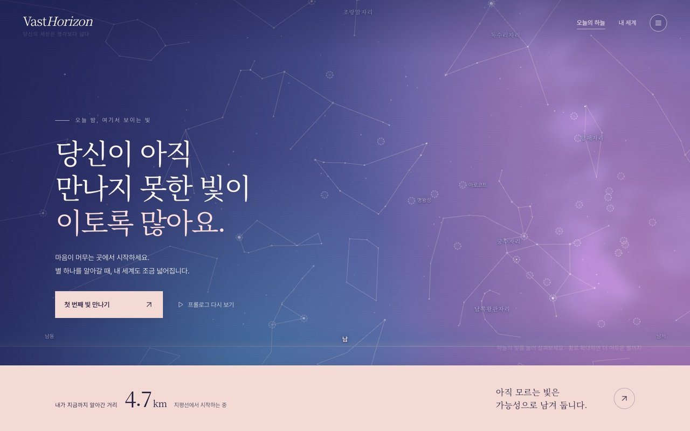
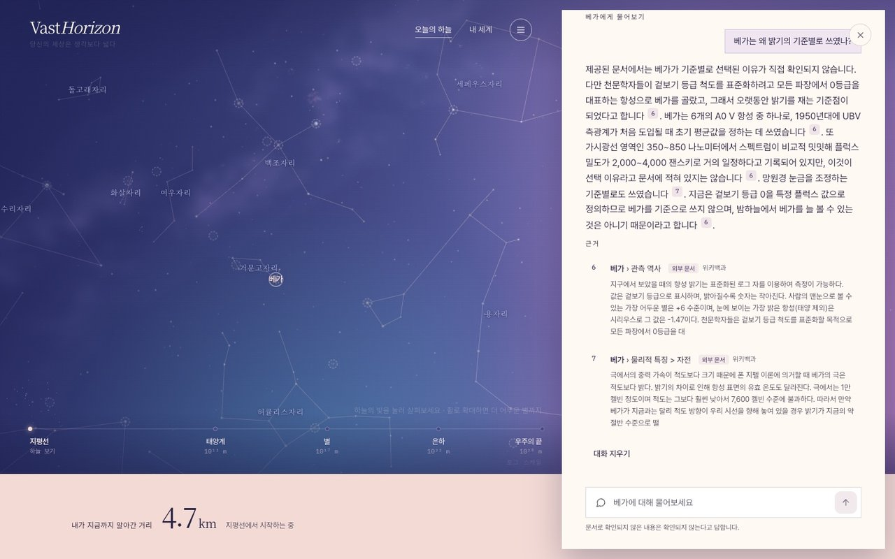
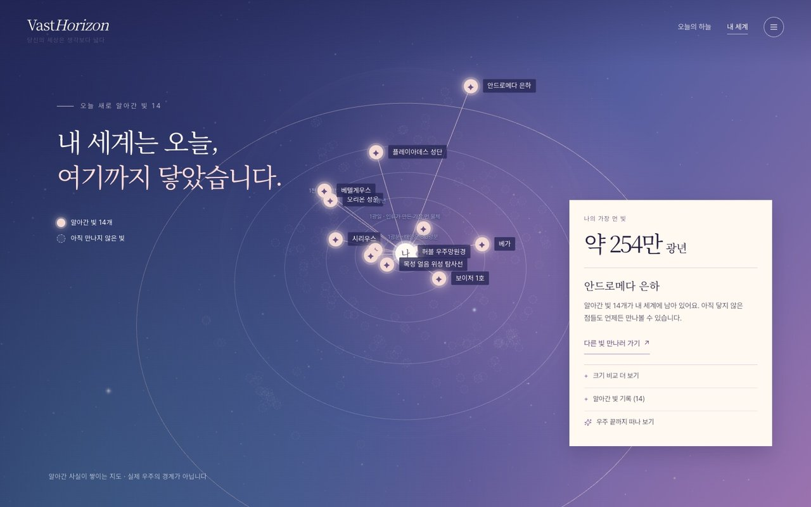
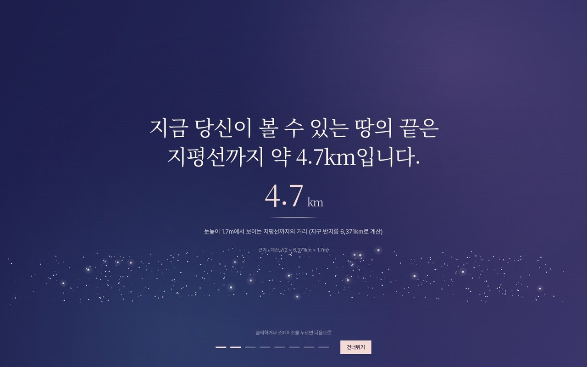
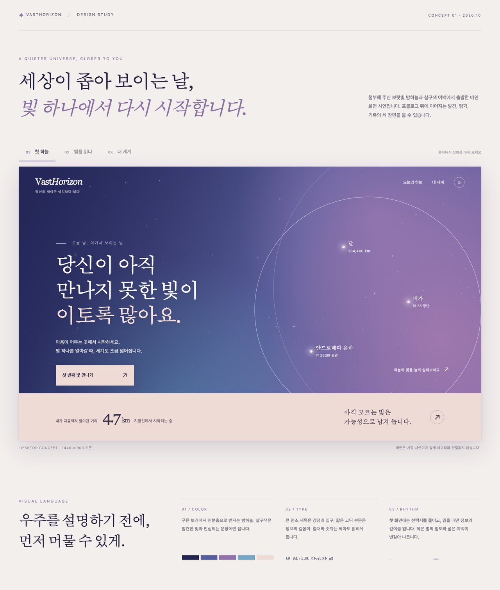
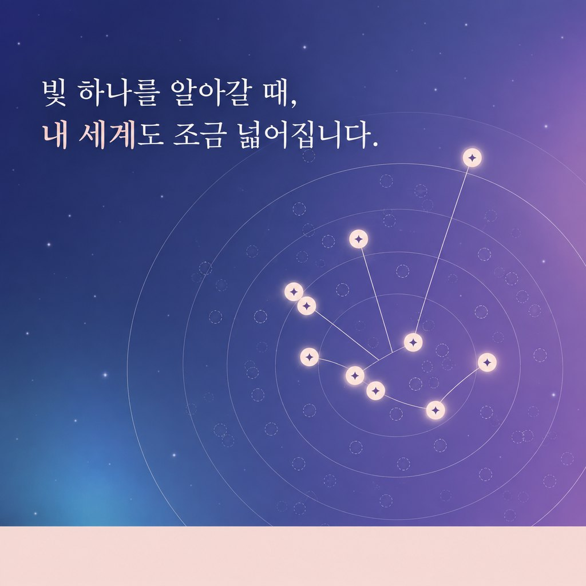
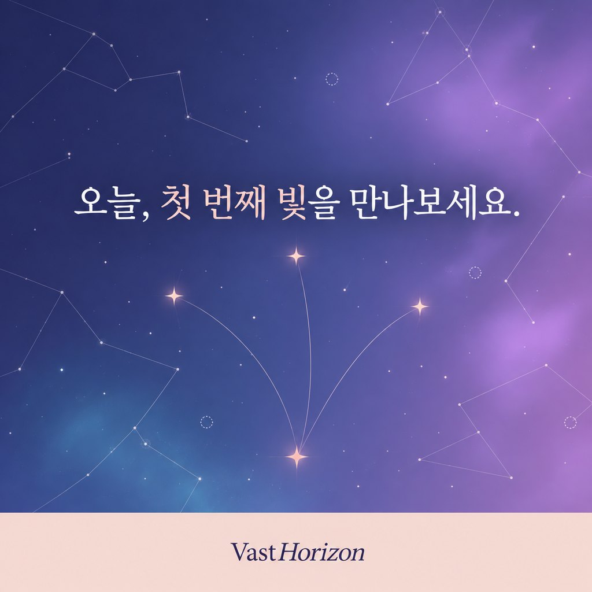

# VastHorizon

## 개요

<figure markdown="span">
    
    <figcaption>프로젝트 로고. 지평선 너머 별로 이어지는 빛의 궤적을 그렸습니다</figcaption>
</figure>

!!! tip "아이템 한줄 설명"
    별 하나를 알아갈 때마다 내 세계가 넓어지는, 사실로 위로하는 우주 안내서

VastHorizon(Vast + Horizon)은 3D 하늘에서 천체를 고르고 질문하면, 한국어 위키백과와 NASA 문서를 모아 색인한 뒤 그 문서에 근거해서만 답하는 RAG 서비스입니다. 사실 문장마다 `[근거 N]` 번호와 원문 링크를 붙이고, 문서에서 확인되지 않는 내용은 확인되지 않는다고 답합니다. 천체를 하나씩 알아갈 때마다 그 빛이 '내 세계'에 더해지며, 지평선까지의 거리인 약 4.7km에서 시작한 내 세계는 가장 먼 빛을 알아가면 우주 끝까지 넓어집니다.

SSAFY 16기 AI 코어 과정에서 받은 "RAG 기반 도메인 지식 서비스"라는 주제에서 출발했고, 도메인으로 우주를 골랐습니다. 2026년 10월 21일에 첫 커밋을 올렸고 10월 23일에 첫 배포를 마쳤습니다. 10월 26일 기준으로 커밋은 56개이고, 기획, RAG, 서버, 3D 화면, 데이터, 배포, 디자인을 모두 혼자 맡았습니다.

### 저장소

<https://github.com/bnbong/VastHorizon>

### 서비스

<https://vasthorizon.bnbong.com>

<figure markdown="span">
    
    <figcaption>키 비주얼. 사이트의 남보라 하늘과 살구색 리본 위에 별자리와 내 세계의 빛을 그렸습니다</figcaption>
</figure>

## 문제와 가치

세상이 유난히 좁고 답답하게 느껴지는 날에 꺼내 볼 수 있는 서비스를 만들고 싶었고, 만들기 전에 이 서비스가 지킬 가치를 세 가지로 정했습니다.

**지어내지 않는 위로.** "괜찮아요"라는 말은 따뜻하지만 근거가 없으면 금방 흩어집니다. 그래서 이 서비스는 위로의 말을 지어내지 않고, 누구나 확인할 수 있는 우주의 사실을 건넵니다. 지금 보이는 안드로메다 은하의 빛이 약 250만 년 전에 출발했다는 사실처럼, 사실은 내일 다시 꺼내 보아도 내용이 그대로입니다. 이 가치가 RAG를 택한 이유이자, 아래에 적은 설계 결정 대부분의 출발점입니다.

**알아가는 만큼 넓어지는 세계.** 천체를 읽고 "이 빛을 내 세계에 담기"를 누를 때마다 내 세계가 넓어집니다. 알아간 천체는 하늘과 목록과 지도에서 같은 살구색 표식(✦)으로 표시되고, 아직 만나지 않은 천체는 빈 점선 원으로 흐리게 남습니다. 이 표현은 배움에 대한 은유이며 천체의 실제 상태에 대한 과학적 주장이 아니라는 점도 함께 밝혀 두었습니다.

**하지 않는 일.** 이 서비스는 전문 심리상담을 대신하지 않습니다. 마음 한 줄에 위기를 뜻하는 표현이 들어오면 LLM보다 코드가 먼저 검사하고, 답 대신 도움을 받을 수 있는 상담 창구를 먼저 안내합니다.

## 무엇을 만들었나

| 첫 하늘 | 읽기 카드 |
|---|---|
|  |  |
| 오늘 밤 여기서 보이는 별자리와 아직 만나지 않은 빛이 떠 있습니다 | 베가에게 밝기의 기준별로 쓰인 이유를 묻고, 인용된 위키백과 근거와 함께 받은 답입니다 |

| 내 세계 | 프롤로그 |
|---|---|
|  |  |
| 알아간 천체 14개가 나에게 이어지고, 가장 먼 빛은 약 254만 광년 떨어져 있습니다 | 지금 볼 수 있는 땅의 끝인 지평선까지의 거리는 약 4.7km입니다 |

- **3D 하늘과 문서 근거 답변**: 히파르코스 별 118,216개와 성운·성단·은하 15,809개가 떠 있는 하늘에서 카탈로그 천체 424개나 아무 별을 눌러 질문하면, 문서에 근거한 답과 인용 근거를 받습니다.
- **내 세계 지도**: 알아간 천체가 '나'에게 이어지는 선으로 쌓이고, 가장 먼 빛까지의 거리가 내 세계의 반지름이 됩니다.
- **빛의 편지**: 별빛이 출발한 해의 지구 기록으로 편지를 씁니다. 천체를 골라 받는 "천체 편지"와 "내가 태어날 무렵 출발한 빛"처럼 내 나이로 찾는 편지를 두 흐름으로 나눴습니다.
- **편지 공유**: 편지를 링크, OG 카드, 세로형 PNG 카드로 공유하거나 카카오톡 피드 메시지로 보냅니다. 마음 한 줄에 적은 문장은 공유 카드에 담기지 않습니다.
- **읽어 주기**: Google Cloud TTS 서버 음성으로 편지를 읽고, 서버 음성을 쓸 수 없으면 같은 클릭에서 기기 음성으로 대신 읽습니다. 서버 음성은 월·일 글자 수 원장을 두어 무료 구간 안에서만 씁니다.
- **관점 전환과 조건 탐색**: 마음 한 줄을 적으면 직접 큐레이션한 서가(위키 13문서, 123청크)를 인용해 우주의 사실로 답합니다. "맨눈으로 볼 수 있는 은하" 같은 자연어 조건으로 천체를 찾을 수도 있습니다.
- **태양계 근접 뷰와 휴대폰 화면**: 태양계 천체 32개를 알려진 특징에 따라 절차적으로 그린 3D 상상도로 가까이서 봅니다. 휴대폰에서는 이 3D를 무대 전체에 띄우고, 서랍을 세 단계 걸림 높이 바텀시트로 바꿨습니다.
- **프롤로그와 사운드**: 처음 켰을 때 지평선 4.7km에서 우주 끝까지 이어지는 8장면 모션그래픽을 보여 주고, 앰비언트와 효과음은 Web Audio로 합성합니다.

## 설계와 의사결정

### 근거 1 고정과 항목 범위 검색

**문제.** 천체 하나를 골라 질문해도, 문서를 검색하면 비슷한 이름을 가진 다른 천체의 문서가 근거에 섞일 수 있습니다. 문서 검색이 아예 실패하는 경우도 있습니다.

**선택과 결과.** 선택한 항목의 메타데이터(Wikidata 기반, 항목당 1청크)를 검색 결과와 관계없이 항상 근거 1로 넣고, 문서 검색은 그 항목의 `item_id` 범위 안에서만 수행했습니다. 그 결과 문서 검색이 실패해도 근거 1만으로 답할 수 있고, 다른 천체의 문서는 구조적으로 근거에 들어오지 않습니다.

### 인용 검증과 그 한계

**문제.** "근거에 기반해 답하라"고 프롬프트에 적는 것만으로는 모델이 실제로 근거를 지켰는지 알 수 없습니다.

**선택.** 답변이 생성되면 코드가 세 가지를 검사합니다. `[근거 N]` 번호가 실제 근거 목록에 있는지, 번호가 하나도 없는 사실 답변이 아닌지, 근거에 없는 다른 문자가 섞이지 않았는지 확인하고, 어긋나면 한 번 다시 생성합니다. 결과는 인용이 확인된 답(`cited`), 문서에서 확인되지 않는다는 답(`not_found`), 보여 주지 않는 답(`rejected`)으로 나뉩니다.

**한계를 밝힌 이유.** `cited`는 인용 형식 검사를 통과했다는 뜻일 뿐, 내용이 맞다는 보증은 아닙니다. 코드는 주장과 근거가 의미상 일치하는지까지 검사하지 않습니다. 이 한계를 숨기면 사용자가 형식 검사를 내용 보증으로 오해할 수 있다고 판단했습니다. 그래서 화면에 인용된 근거의 발췌와 원문 링크를 함께 보여 주어, 읽는 사람이 직접 대조할 수 있게 했습니다.

### 청킹과 top-k는 실험으로 정했습니다

청크 크기는 감으로 정하지 않고, JWST 문서 8건(81,417자)과 보이저 1호 문서 12건(70,174자)을 설정만 바꿔 가며 잘라 보고 정했습니다.

| 크기 / 겹침 | JWST 청크 수 | 보이저 1호 청크 수 | 평균 길이 |
|---|---:|---:|---:|
| 500 / 100 | 253 | 214 | 약 355자 |
| 1000 / 0 | 121 | 104 | 약 695자 |
| **1000 / 200** | **123** | **105** | **약 700자** |
| 1500 / 300 | 80 | 74 | 약 1,000~1,070자 |
| 2000 / 400 | 64 | 57 | 약 1,260~1,350자 |

500자로 자르면 위키 한 문단이 갈라지고, 2,000자로 자르면 한 청크에 절이 여러 개 들어가 검색 정확도가 흐려집니다. 위키백과 한 절이 대략 1,000자이므로 1,000자로 자르면 근거 하나가 의미 하나와 맞습니다. 겹침 200은 긴 절이 문장 중간에서 끊길 때 생기는 손실을 막으려고 두었습니다.

top-k는 "보이저 1호는 태양계를 벗어났나?"라는 질문으로 3, 6, 10을 유사도 검색과 MMR에서 비교했습니다. 6개에서 답에 필요한 절이 모두 모였고, 10개에서는 질문과 먼 절이 섞였습니다. MMR은 점수가 낮은 개론 청크를 끌어왔기 때문에, 기본값은 유사도 검색과 top-k 6으로 정했습니다.

### 임베딩 모델: 품질 대신 응답성을 택했습니다

**문제와 실측.** Claude API에는 임베딩 API가 없어서, 서버 안에서 torch 없이 실행되는 fastembed(ONNX) 다국어 모델이 필요했습니다. 실제로 모은 문서 113청크에서 한국어 질문 4개의 정답 청크가 몇 번째로 검색되는지 세 모델을 비교했습니다.

| 모델 | 크기 | 정답 청크 순위(질문 4개) | 청크당 시간(ARM 2코어 서버) |
|---|---|---|---|
| `multilingual-e5-large` | 2.2GB, 1024차원 | 1, 1, 1, 1 | 5.3초 |
| `paraphrase-multilingual-mpnet-base-v2` | 1.0GB, 768차원 | 17, 1, 9, 2 | 1.6초 |
| `paraphrase-multilingual-MiniLM-L12-v2` | 0.22GB, 384차원 | 12, 2, 1, 1 | 0.15초 |

**판단.** 품질만 보면 e5-large가 가장 정확했습니다. 그러나 ARM 2코어 서버에서는 문서가 긴 천체에 대한 첫 질문이 5분 넘게 걸렸고, 비스트리밍 요청은 Nginx의 120초 제한에 걸려 504로 끝났습니다. 아무리 정확한 답이라도 사용자가 받지 못하면 의미가 없다고 판단해 MiniLM을 기본 모델로 정했습니다. 한 질문에서 정답 순위가 12위로 떨어지는 손해는 근거 1 고정과 top-k 6이 일부 보완합니다. GPU나 빠른 x86 서버에서 운영한다면 e5-large를 쓰는 편이 좋을 것 같습니다.

### 비용 통제

공개 서비스에서 LLM을 부르는 만큼, 비용이 예상 밖으로 늘지 않도록 장치를 여러 겹으로 두었습니다.

- **역할 분담**: 검색어 추출과 후보 선별처럼 짧은 JSON만 만드는 단계는 Haiku로, 사용자에게 보이는 답은 Sonnet으로 처리합니다.
- **응답 캐시**: 같은 요청에는 저장해 둔 응답을 돌려주며, 캐시에 적중한 응답은 호출 한도와 예산을 쓰지 않습니다.
- **사용량 기록과 하루 예산**: LLM 호출마다 토큰 수와 추정 비용을 JSONL로 기록하고, 추정 비용이 하루 예산을 넘으면 새 호출을 막습니다.
- **IP 한도**: 사용자별 1분 6회, 하루 60회, 서버 전체 하루 1,500회로 호출을 제한합니다. 전달 헤더를 바꿔 한도를 우회하지 못하도록, 믿을 수 있는 프록시에서 온 연결의 헤더만 읽습니다.
- **조건 탐색의 규칙 경로**: 자연어 조건을 동의어 표로 먼저 해석하고, 규칙만으로 완전히 해석되면 LLM을 한 번도 부르지 않습니다.

### 휴대폰 UX 재설계

**문제.** 데스크톱 화면을 그대로 줄이면 휴대폰 세로 화면에서는 서랍의 설명이 3D 근접 뷰를 가렸습니다. 이 서비스에서 3D로 천체를 보는 경험은 핵심이었기 때문에, 화면을 줄이는 대신 상호작용을 다시 설계했습니다.

**선택.** 태양계 천체와 블랙홀의 3D 근접 뷰를 무대 전체에 띄우고, 서랍은 peek · half · full 세 단계에 멈추는 바텀시트로 바꿨습니다. 3D가 있는 천체는 시트를 엿보기 높이(peek)로 열어 이름, 한 줄 설명, 담기 버튼만 보여 줍니다. 3D와 시트가 같은 화면에서 끌기 제스처를 받기 때문에 충돌 규칙을 정했습니다. 3D 위에서 끌면 천체가 회전하고, 시트는 손잡이와 머리글, 또는 본문이 맨 위까지 스크롤된 상태에서 아래로 끌 때만 움직입니다.

**검증.** 걸림 높이 계산은 DOM과 분리한 순수 함수로 두어 Node 테스트로 확인했고, 데스크톱 화면은 변경 전후를 픽셀 비교해 차이가 0인지 확인했습니다.

**WebGL에서 배운 점.** 3D 뷰를 정리할 때 `forceContextLoss()`로 WebGL 컨텍스트를 놓아 주는데, 그 캔버스를 다시 쓰면 잃은 컨텍스트를 돌려받아 두 번째 천체부터 그림이 나오지 않았습니다. 그래서 3D 뷰를 띄울 때마다 캔버스를 새로 만들도록 바꿨습니다.

### 배포 파이프라인

화면은 정적 Nginx 서버에, API는 컨테이너 서버에 올려 개인 서버 두 대로 나눴습니다. `main`에 서비스 코드가 바뀐 커밋이 올라오면 GitHub Actions가 다음 순서로 배포합니다.

1. 서버가 ARM 기반이므로 ARM 러너에서 `linux/arm64` 이미지를 빌드해 GHCR에 올립니다.
2. API 컨테이너를 방금 만든 이미지의 digest로 고정한 참조로 교체하고, health 확인이 실패하면 이전 이미지로 자동으로 되돌립니다.
3. API 배포가 성공한 뒤에만 화면 파일을 맞춥니다. 새 화면이 새 API에 기대는 경우가 많기 때문입니다.
4. 배포가 성공하면 운영 중인 이미지와 롤백용 이미지를 남기고 이전 이미지를 자동으로 정리합니다.

서버 주소와 경로는 저장소에 적지 않고 GitHub의 secret과 environment variable로 받습니다.

## 데이터와 출처

카탈로그 항목은 424건이며, 1차 출처는 Wikidata(CC0)입니다.

| 그룹 | 개수 | 보강 출처 |
|---|---:|---|
| 태양계 | 32 | JPL Horizons |
| 인류의 발자취(위성·탐사선) | 100 | CelesTrak SATCAT, JPL Horizons |
| 별 | 94 | 연주시차로 거리 교차 검증 |
| 메시에 천체 | 110 | d3-celestial |
| 별자리 | 88 | d3-celestial |

별까지의 거리는 연주시차가 5mas 이상인 별에 한해 교차 검증하며, 먼 별은 측정 오차가 크기 때문에 이 값을 '실제 거리'가 아니라 '카탈로그 거리'라고 부릅니다.

| 출처 | 쓰임 | 이용 조건 |
|---|---|---|
| Wikidata | 항목 메타데이터 | CC0 1.0 |
| 한국어 위키백과 | 외부 문서, 천체 소개 | CC BY-SA 4.0 |
| NASA NSSDCA, JPL Horizons | 탐사선 미션 설명, 천체와 탐사선 위치 | 미국 정부 저작물 |
| CelesTrak SATCAT | 위성 궤도, 운용 상태 | 무료 공개, 출처 표기 |
| d3-celestial | 히파르코스 별, 성운·성단·은하, 은하수 윤곽, 별자리 선 | BSD-3-Clause |
| NASA Hubble's Messier Catalog | 메시에 천체 사진 89장 | NASA 자료는 공개, 함께 표기된 기관의 사진은 그 기관의 조건 |
| NASA 3D Resources | 위성, 탐사선 3D 모델 4개 | NASA 미디어 이용 지침 |

## 디자인

디자인은 기능 개발과 따로 시안부터 잡았습니다. 10월 22일에 '첫 하늘', '빛을 읽다', '내 세계' 세 장면으로 콘셉트 시안을 만들고, 팔레트와 폰트, 상태 표시 방식을 디자인 적용 명세로 정리했습니다. 10월 23일에는 몽환적인 팔레트와 알아간 만큼 넓어지는 내 세계를 화면에 반영했고, 10월 24일에는 '밤하늘 위의 편지'라는 방향으로 디자인을 한 번 더 개편했습니다.

<figure markdown="span">
    
    <figcaption>디자인 시안 중 '첫 하늘' 장면</figcaption>
</figure>

| 이름 | 색 |
|---|---|
| 남보라 | `#222454` |
| 흐린 보라 | `#9970AF` |
| 푸른빛 | `#63A9C9` |
| 살구 | `#F3DAD5` |
| 종이 | `#FFFAF5` |

제목에는 Noto Serif KR을, 본문에는 Pretendard를 썼습니다. 색을 구별하기 어려운 사람도 상태를 알아볼 수 있도록, 알아간 천체와 아직 만나지 않은 천체를 색만이 아니라 채움, 윤곽, 선, 이름표로도 구별하게 했습니다.

홍보용으로는 1254px 정사각형 카드 4장을 만들었습니다.

| 표지 | 발견 |
|---|---|
|  |  |
| "당신의 세상은 생각보다 넓습니다." | "빛 하나를 알아갈 때, 내 세계도 조금 넓어집니다." |

| 지식 | 초대 |
|---|---|
|  |  |
| "위로를 지어내지 않고, 사실로 위로합니다." | "오늘, 첫 번째 빛을 만나보세요." |

## 결과와 배운 점

### 결과

- 첫 커밋 이틀 뒤인 10월 23일부터 공개 서비스로 운영하고 있습니다.
- Python 테스트와 JavaScript 테스트로 RAG, API, 시트 계산, 공유와 읽어 주기 같은 동작을 확인합니다.

### 배운 점

- **RAG의 신뢰는 모델이 아니라 구조에서 나왔습니다.** 프롬프트에 "근거만 쓰라"고 적는 것보다, 근거 1을 고정하고 검색 범위를 좁히고 인용을 코드로 검사하는 편이 훨씬 확실했습니다. 그리고 그 검사가 무엇을 보증하지 않는지도 사용자에게 밝혀야 한다는 점을 배웠습니다.
- **공개 서비스에서는 품질보다 응답성과 비용 상한이 먼저일 때가 있습니다.** 가장 정확한 임베딩 모델은 실제 서버에서 504를 냈습니다. 노트북에서의 측정이 아니라 운영 서버에서의 실측으로 결정해야 한다는 점을 확인했습니다.
- **모바일은 데스크톱을 줄인 화면이 아니었습니다.** 휴대폰에서는 3D와 시트가 같은 손가락 제스처를 두고 다투기 때문에, 배치를 줄이는 것이 아니라 제스처 규칙부터 다시 정해야 했습니다.

## 앞으로

VastHorizon은 아직 개발이 진행 중입니다. RAG 2단계 작업은 실제 사용량이 쌓인 뒤에 무엇이 필요한지 보고 정할 예정입니다. 휴대폰 화면은 여러 실기기에서 제스처와 성능을 검증하고 있습니다.

## 기술 스택

| 영역 | 기술 |
|---|---|
| 서버 | FastAPI, SSE, Pydantic (Python 3.11 이상) |
| RAG | LangChain, LangGraph, Chroma |
| 임베딩 | fastembed `paraphrase-multilingual-MiniLM-L12-v2` (서버 안 로컬 계산, ONNX) |
| LLM | Claude API (Sonnet 답변, Haiku 구조화) |
| 음성 | Google Cloud Text-to-Speech, 기기 음성(speechSynthesis) 폴백 |
| 화면 | three.js r170, Lucide 아이콘, Pretendard, Noto Serif KR, 프레임워크 없는 HTML/CSS/JS 모듈 |
| 배포 | Docker(ARM64 이미지, GHCR), GitHub Actions, Nginx, Cloudflare |
